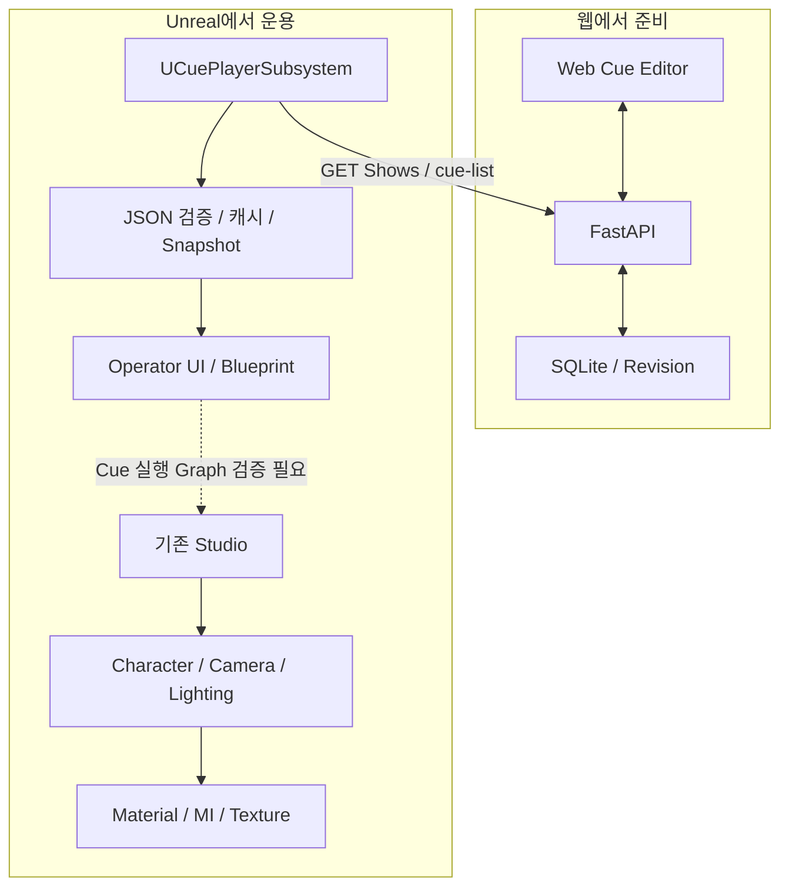
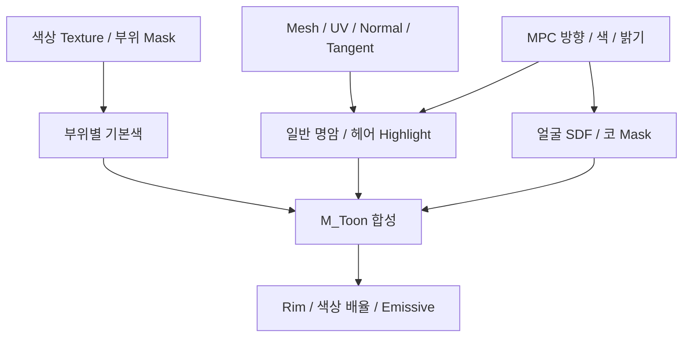

# Real-time Virtual Performer Studio 발표 설계 및 기술 검수 문서

버전: 검토 초안 1.0 / 작성 기준: 2026-11-19 KST

작업 범위: Phase 1 프로젝트 분석, Phase 2 발표 설계

상태: 사용자 구성 검토 및 실제 프로젝트 사실관계 검증 대기

PPTX, 발표용 PDF, 디자인 초안은 아직 제작하지 않음 / Notion 수정 없음

## 1. 발표의 중심과 전제

**기존 실시간 Studio를 기반으로 Bounty Hunter의 표현을 Toon 스타일로 바꾸기 위해 Material, Texture, 헤어 Mesh, UV, Vertex Normal을 함께 수정하고, 추가로 웹 기반 Cue 준비와 Unreal 데이터 연동을 구성한 프로젝트**

프로젝트명은 기존 `Real-time Virtual Performer Studio` 유지 제안

부제: `Toon 표현 변경과 Web Cue 연동`

초기 두 번째 기획서의 `Stylized Character LookDev & Motion Lab`은 Motion 관련 목표까지 포함하므로 현재 최종 발표 제목으로 그대로 사용하지 않음

- 게임 소개, 직무 홍보, 독자 렌더링 기술 개발의 형태로 구성하지 않음
- 첫 프로젝트의 Studio는 재사용 기반으로 소개
- 이번 작업의 중심은 Toon 표현을 위한 학습, 에셋 분석, 노드 구성과 데이터 수정
- Web/Cue는 최종 시스템의 추가 기능으로 포함하되 서버 문서 분량에 비례해 발표 비중을 늘리지 않음
- AI 활용은 결과물의 유무와 별개로 작업별 역할을 밝힘
- 화면 결과, 저장된 Graph, 코드, 자동 테스트가 각각 입증하는 범위를 분리

### 발표 시간 가정

읽은 학생용 베이스와 기획서에서 최종 발표 제한 시간을 확인하지 못함

**시연 75초를 포함한 발표 15분, 질의응답 별도**를 설계 가정으로 사용

본편 17장 / 질의응답용 부록 6장 / 부록은 기본 발표 시간에 포함하지 않음

| 영역 | 슬라이드 | 시간 | 비중 |
|---|---|---:|---:|
| Toon 결과, 구현, 데이터 작업, Studio 연동 | 2, 5~12 | 520초 | 57.8% |
| Web/Cue 소개, 구조, 문제 해결 | 13~15 | 150초 | 16.7% |
| 기존 기반, 목표, 표지, 범위와 회고 | 1, 3, 4, 17 | 155초 | 17.2% |
| 통합 시연 | 16 | 75초 | 8.3% |
| 합계 | 본편 17장 | 900초 | 100% |

시연 중 Toon/Studio 40초, Web/Cue 35초를 배정하면 Toon 관련 설명과 시연은 약 62% 수준

이 비율은 발표 시간 배분이며 작업시간이나 기여율의 측정치가 아님

## 2. 자료 목록과 실제 열람 범위

### 2.1 출처 식별자

아래 식별자는 이 문서 안에서 근거를 추적하기 위한 것

| ID | 자료 | 실제 확인 범위 | 제한 |
|---|---|---|---|
| S1 | `PresentationTechnicalReport(3).md` | 전체 534행 열람 / 프로젝트 개요, C++, 서버, 테스트, 기여 범위 분석 | 보고서 작성자가 수행한 검증과 이번 설계 작업을 구분 |
| S2 | `Toon_Shader_Technical_Record(4).md` | 전체 1348행 열람 / 특히 현재 검증 0절과 수정된 3절 우선 | 후반에 과거 설명과 현재 설명이 함께 남아 있음 |
| S3 | `Real-time Virtual Performer Studio 기획서 (Bounty Hunter 에셋 사용)(4).pdf` | 31페이지의 기획 텍스트 확인 | 기획이며 완료 증거 아님 / 초기 명칭과 상태 규칙이 개발 기록과 다름 |
| S4 | `두 번째 프로젝트 기획서.pdf` | 9페이지 전체 텍스트 확인 | 초기 목표 / Hair Physics, Foot IK, Facial, 시간 전환을 완료로 취급하지 않음 |
| S5 | `학생용_게임프로젝트_발표자료_베이스(난 게임 아니니까 구조 참고만)(1).pdf` | 18페이지 전체 텍스트 확인 | 항목 구성 참고 / 별도 평가표나 강사 필수 지시까지 확보한 것은 아님 |
| S6 | `내가_한_것들.pdf` | 이번에 접근한 118페이지 판본에서 Animation, StudioManager, UI, Appearance 관련 구간 확인 / pp.1~7, 61~65, 83~94 중심 | 118페이지 전체 정독 또는 이미지 전수 검수는 하지 않음 / S1의 87페이지 기준 인용과 페이지 번호 혼용 금지 |
| S7 | `웹서버_실습_내용(1).pdf` | 37페이지 판본에서 Ranking UI, `RankingSubsystem.cpp`의 HTTP/JSON 예제 구간 확인 | 학습 배경이며 현재 Cue 코드가 이 파일과 같다는 근거 아님 |
| S8 | `면담 스크립트.txt` | 진로와 프로젝트 방향 관련 면담 내용 확인 | 개인 정보와 취업 평가, 강사의 전망은 발표 본문에서 제외 |
| S9 | 접근 가능한 이전 대화 맥락 | Texture 변환 요구, 회색 헤어, SDF 이미지 단계, FaceShadowMask, 눈 Texture, 5종 외형 요청 | 원본 대화 전체를 새로 열람한 것은 아님 / 완료 증거로 단독 사용하지 않음 |
| L1 | 실제 폴더 `C:\Work\Unreal_Engine\MultiProject` | 디렉터리, 일부 코드, 일부 저장된 Audit JSON, 테스트 기록 읽기 | Editor Play, 새 빌드, 테스트 재실행 없음 / Git HEAD 재조회는 접근 제한으로 실패 |

S1: [기술 보고서](https://chatgpt.com/library?file_id=libfile_507269cd77b08191b7a1e5643db9a444&account_id=personal)

S2: [Toon 기술 기록](https://chatgpt.com/library?file_id=libfile_51e45e95b3a481919686232b8d1db57d&account_id=personal)

S3: [첫 프로젝트 기획서](https://chatgpt.com/library?file_id=libfile_ee9a60877c308191b113224c6105d3fd&account_id=personal)

S4: [두 번째 프로젝트 기획서](https://chatgpt.com/library?file_id=libfile_93d4b2a7625081919e026771d47a10e2&account_id=personal)

S5: [발표 베이스](https://chatgpt.com/library?file_id=libfile_9b7c2404794c81919b86eaa6bf9f1e2f&account_id=personal)

S6: [첫 프로젝트 개발 기록](https://chatgpt.com/library?file_id=libfile_8baf63e1e4c08191bd9df347adc32928&account_id=personal)

S7: [웹서버 실습](https://chatgpt.com/library?file_id=libfile_c1d0b7996f888191b1edb080651c1049&account_id=personal)

S8: [면담 원문](https://chatgpt.com/library?file_id=libfile_caec8eb65ebc81918bc8b35135e088e1&account_id=personal)

### 2.2 이번 작업에서 원본을 확보하지 못한 자료

- `Toon Shader 공부` / `Toon_Shader_공부.pdf`: 이름 변형을 포함해 검색했으나 원본 파일을 찾지 못함
- S2가 R1이라고 부르는 참고 PDF의 원본 pp.58~88, 107~126, 152~160: 직접 열람하지 못함
- 과거 `G1` Material Graph 원본: S2의 현재 Export 요약과 구분 / 과거 원본 자체는 재열람하지 않음
- 최종 Play 영상, 최신 Web Cue Editor 실행 캡처, 동일 조건 Original/Toon 비교 영상: 미확보
- Maya 원본 작업 파일과 Soften Edge 전후 화면, UV 전후 화면, Painter 원본: 미확보
- `LightDir/LightColor` 최종 writer, 전체 Cue 실행 Graph, 실제 Slot/MID 목록: 추가 확인 필요

자료 미확보를 기능 미구현과 동일하게 취급하지 않음

### 2.3 이번에 실제 코드/기록과 교차 확인한 항목

L1에서 읽은 파일은 원본 수정 없이 대조용으로만 사용

| ID | 파일 또는 기록 | 이번에 직접 확인한 내용 |
|---|---|---|
| L1a | `CueServer/app/cues/router.py` | `/api/v1/shows` 하위 CRUD, `cue-order`, `cue-list`, 저장된 Snapshot 응답 |
| L1b | `CueServer/app/cues/schemas.py` | Camera `Full/Upper/Close/Stage`, Lighting `Neutral/Focus/Stage`, Animation `Idle/Talk/Dance`, 시간 필드 |
| L1c | `Source/NetworkProject/Private/CuePlayerSubsystem.cpp` | `Initialize`, `SelectShow`, `RestoreSelectedSnapshot`, `HandleCueResponse`의 관련 구간 / 미선택 시작과 응답 보호 |
| L1d | `Source/NetworkProject/Private/CueJson.cpp` | v2 필드 계약, `Stage` 허용, 상태값과 시간 범위 검증 |
| L1e | `Saved/ToonAudit/MI_Face_Toon.json` | `IsFace?=true`, `RimLight?=false`, `T_Head_N_Toon`, 상속된 유효값과 로컬 Override 구분 |
| L1f | `Saved/ToonAudit/current_verified.md` | S2의 현재 검증 0절과 대조 / 이것도 검증 결과 요약문이며 새 Graph 실행 검증 아님 |
| L1g | `Saved/CueImplementation/startup-green-report/index.json` | 성공 6, 경고 포함 성공 1, 실패 0, 미실행 0 |
| L1h | `Saved/CueStageFix/server-tests.log` | `37 passed, 1 warning in 5.88s`의 보존 기록 |
| L1i | `Image/Demo.PNG` | 직접 이미지 열람 / 포스터가 배치된 UI 구성 이미지 / 현재 Unreal 실행 결과의 증거로 사용 금지 |
| L1j | `Texture/ToonVer.png` | 직접 이미지 열람 / Toon 스타일의 포스터형 참고 이미지 / 프로젝트 렌더 결과와 구분 |

보고서에 기록된 Git HEAD `4ab28a985b13e5b9cd005d9f144f19b8e3f02e5c`는 S1 작성 당시 기준

이번 작업에서 현재 HEAD가 같다고 재확정하지 못했으므로 최종 검증 시 commit, 저장 상태, 촬영 시점을 함께 기록

## 3. Phase 1 프로젝트 종합 분석

### 3.1 첫 프로젝트와 두 번째 프로젝트의 차이

| 구분 | 첫 프로젝트에서 구축한 기반 | 두 번째 프로젝트의 중심 작업 |
|---|---|---|
| 목적 | 캐릭터와 무대의 상태를 한 화면에서 운영 | 캐릭터의 표현 방식을 Toon 방향으로 변경하고 기존 운용 환경에 연결 |
| Animation | Retargeting, Idle/Talk/Dance, Gesture, 이동 연동, Look Tracking | 기존 기반 활용 / 신규 Foot IK와 Hair Physics 완료 근거 없음 |
| Camera/Lighting | 구도 전환, Stage View, 무대 조명 상태 | Toon 입력과 기존 Lighting 데이터 연결 / 모든 광원 writer는 미확정 |
| Appearance | MID와 색상/외형 Preset 제어 | 공용 Toon Material, 부위별 MI, Original/Toon 전환 경로 |
| 에셋 작업 | 외부 캐릭터 통합, 기존 Material 활용 | Texture 변형, 입체 헤어 초안 수정, UV 방향 정리, Normal 수정 |
| 외부 데이터 | 첫 기획에서는 웹/Cue 제외 | Web Cue Editor, FastAPI/SQLite, C++ 조회/검증/캐시, Blueprint 실행 연결 |
| 발표의 위치 | 기반 1장과 짧은 시연 | Toon 기술과 데이터 작업을 중심으로 설명 |

첫 기획서의 `BP Runtime Controller Component` 구조를 현재 클래스명으로 복사하지 않음

현재 개발 기록의 중심은 `WBP_Operator`, `BP_StudioManager`, `BP_BountyHunter`이며 C++ 데이터 계층은 `UCuePlayerSubsystem`

### 3.2 목표 스타일과 작업 연결

| 원하는 표현 | 학습/적용 기술 | 관련 데이터 작업 | 최종 결과를 입증할 화면 |
|---|---|---|---|
| 명암 경계가 정리된 캐릭터 | Normal 내적, Remap, SmoothStep, 색 합성 | Base Color의 기존 고정 명암 조절, Normal 파생본 | 같은 조명에서 Original/Toon 전신과 상체 |
| 얼굴의 단순한 그림자 형태 | 머리 상대 방향, 좌우 SDF, 범위 Mask | 각도별 그림자 이미지, SDF/FaceShadowMask | 동일 얼굴에서 Normal/SDF 비교, 정면/좌우 광원 |
| 띠 형태 헤어 Highlight | Normal/Tangent 방향축, 광원/시점 조합, Power | 입체 헤어, UV 방향, Vertex Normal, Value Texture | 카메라 또는 광원 한 변수만 바꾸는 짧은 영상 |
| 기존 눈의 조절 기능 유지 | 기존 눈 UV/홍채/동공 계산 재사용 | Iris/Sclera 파생 Texture | 실제 눈 MI 적용 확인 후 근접 컷 |
| 정돈된 외곽과 색감 | 별도 Outline, Fresnel Rim, Multiply/Lerp | Outline Mesh/MI 적용, 부위별 Rim 선택 | 효과별 ON/OFF, 거리별 외곽선 |
| Studio 안에서 표현 변경 | Material 교체, MID, DataTable, MPC | Original/Toon 배열과 부위별 MI | 모드 전환, 색상 Preset, 조명 전환 연속 영상 |

Shader만 수정한 결과로 서술하지 않음

Texture는 고정된 색/패턴, UV와 Tangent는 방향 기준, Vertex Normal은 표면 방향, Material은 입력을 조합하는 계산, Blueprint는 운용 중 값을 전달하는 역할로 설명

### 3.3 현재 구현 상태 판정

이 문서의 `저장 연결 확인`은 S2의 Audit 결과를 근거로 한 판정 / 이번 작업에서 모든 `.uasset` 내부를 새로 분석한 뜻은 아님

| 항목 | 상태 | 발표에 사용할 수 있는 설명 | 추가 검증 |
|---|---|---|---|
| 공용 `M_Toon` | 저장 연결 확인 | 부위별 색상/명암 계산을 공용 Material에 구성 | 실제 Slot/MID 적용 |
| 일반 Toon 명암/Highlight | 저장 연결 확인 | `PixelNormalWS`와 `-MPC_Toon.LightDir` 내적 후 경계 조절 | 실제 LightDir writer와 화면 방향 |
| 얼굴 SDF | 저장 연결 확인 | 좌우 Texture, XY 방향 비교, Power/SmoothStep, FaceShadowMask | 극단 광원, 머리 기울임, Mask 픽셀 범위 |
| 고정 얼굴 그림자 | 저장 연결 확인 | `(1 - T_DefaultShadow.R) * FaceLit` | 실제 픽셀과 sRGB 중간값 결과 |
| 코 Highlight | 저장 연결 확인 | 좌우 마스크를 선택해 얼굴 Highlight로 합성 | 그림자 차단은 출력 경로에 없음 |
| 헤어 Mesh/UV/Normal 수정 | 과거 직접 작업 기록 | Tripo 초안의 분리/UV/Soften Edge 작업 | Maya 파일과 전후 화면 |
| 헤어 방향성 Highlight | 저장 연결 확인 | `Cross(N,T)` 방향축과 광원/시점 조합, Power 마스크 | 최종 Mesh의 UV/Tangent 방향과 화면 |
| `T_HairValue` | 저장 연결 및 제작 기록 | `Hair_Color * T_HairValue.R` | Painter 원본과 최종 Import 일치 |
| Texture 재작업 | 작업 기록 및 Toon Texture 참조 | AI 보조 변형, 사용자 수정 요구와 선택/적용 | 최종 버전, UV/Mask/이음새 검수 |
| 기존 Eye 계산 통합 | 저장 연결 확인 | `IsEye?`에서 기존 UV/색상/Normal 경로 재사용 | 실제 눈 Slot 적용 / 전체 원본 동등성은 미입증 |
| Outline | Shader 구현 확인 | 별도 `M_Outline`의 WPO, Mask, 거리 보정 | 추가 Mesh, 애니메이션 추종, 실제 두께 |
| Rim | 저장 연결 및 과거 개선 기록 | 시점 기반 마스크와 곱셈/Lerp 합성 | 실제 MI별 ON/OFF와 노출 영향 |
| Original/Toon | 일부 BP 경로 확인 | Manager→Character→Material 교체/MID 생성 경로 | 배열 초기화, 실제 슬롯, 반복 전환 |
| Appearance/Lighting 연동 | 일부 BP 경로 확인 | 피부 파라미터 이름 일치, `LightIntensity` 전달 | 5종 Preset, LightDir/LightColor writer |
| Web Cue Editor | S1 코드 분석 확인 | Show/Cue 편집, 순서, 복제 초안, 저장 후 조회 | 최신 브라우저 동작/화면 |
| FastAPI/SQLite/REST | 코드 및 보존 테스트 확인 | 저장, 검증, Revision Snapshot 발행 | 실제 발표 서버 환경 |
| C++ 데이터 계층 | 코드 및 보존 테스트 확인 | 조회, 전체 JSON 검증, 로컬 캐시, 늦은 응답 차단 | 현재 빌드 통합 |
| GO/END SHOW/RESET | 개발 이력과 UI 에셋 / 현재 실행 미확정 | Blueprint에서 씬 실행을 담당하는 구조 | 전체 Graph, 실제 실행/중단/초기화 |
| Cue별 Camera Blend/Lighting Fade | 시간 데이터만 확인 / 실행 범위 제외 | 호환 필드 보존 | 완료 기능으로 표시하지 않음 |
| 신규 Hair Physics/Foot IK/Facial | 기획만 확인 | 초기 기획 항목 | 없다고 단정하지 않고 완료 목록에서 제외 |

### 3.4 자료 충돌을 해결한 기준

| 충돌 | 채택한 판단 | 근거 |
|---|---|---|
| 첫 프로젝트 UE 5.7.4 기록 / 최신 UE 5.8 | 최종 프로젝트는 S1의 `.uproject` 분석 기준 UE 5.8 / 이전 버전은 과정 기록 | S1 §3 / 최종 화면 버전 재확인 |
| 초기 ASP.NET Core/LocalDB 계획 / FastAPI/SQLite | 최종 구현 설명은 FastAPI/SQLite | S4 p.5, S1 §6, L1a/L1b |
| 초기 Cue Shader Preset / v2 계약 | 현재 Cue에 Shader Mode 필드 없음 / Original/Toon 선택은 별도 | S1 §6.2, L1d |
| 3단계 Ramp 계획 / 현재 SmoothStep 합성 | 명암과 Highlight 경계를 조정하는 구조로 설명 / 단계 수를 확정하지 않음 | S2 §3.2 |
| 기본 얼굴 그림자 Min 제안 / 최신 Multiply | Multiply가 현재 출력 경로 | S2 §0.1, §0.3, §3.4 |
| Custom 광원 노드 / 최신 MPC | 일반/SDF/헤어 모두 MPC 경로 / Custom은 미사용 | S2 §0.1~0.3 |
| 피부 파라미터 이름 불일치의 과거 기록 | 현재 `SkinHue_Global/SkinDepth_Global`로 BP와 일치 | S2 §0.1, §3.10 |
| Master 원본 Normal / 얼굴 MI | 얼굴 MI 유효값 `T_Head_N_Toon` | S2 §0.4, L1e |
| `M_Cloth_Toon` 과거 잘못된 명칭 | 별도 Master 성과로 쓰지 않음 / `MI_Cloth_Toon`과 혼동하지 않음 | S2 §3.10, §0.4 |
| 보고서 S1의 Blueprint 미열람 / S2의 일부 BP Export | Toon 관련 일부 경로는 S2로 보강 / 전체 Cue 실행 검증으로 확대하지 않음 | S1 검증 범위, S2 §0.6 |
| `내가_한_것들.pdf` 87페이지 / 접근본 118페이지 | 파일 판본 차이 유지 / 주제와 함수명으로 대조 | S1 범위 설명, S6 메타데이터 |

### 3.5 기여 범위

| 작업 | 외부/AI 범위 | 사용자 작업으로 설명 가능한 범위 | 표현 제한 |
|---|---|---|---|
| 캐릭터 몸/얼굴/의상/기본 Skeleton | Bounty Hunter 외부 Asset | 구조 분석, 통합, 필요한 표현 변경 | 캐릭터 전체 직접 제작 X |
| 기존 Studio | 외부 Animation 활용 | Retarget, Animation/운용 Blueprint, UI/상태 연결은 개발 기록 기준 | 모든 Asset 직접 제작 X |
| Toon 계산 | 학습 PDF와 AI 설명 참고 | 노드 구성, 프로젝트에 맞춘 연결/조정 | 독자 알고리즘 발명 X |
| 헤어 | Tripo AI 초기 Mesh | Maya 분리, UV 재전개/정렬, Vertex Normal 수정 | 처음부터 전부 수작업 모델링 X |
| Base Color/눈/SDF 이미지 | AI 생성/편집 보조 | 목표 정의, 결과 평가, 수정 요청, 선택과 Material 적용 | 모든 픽셀 직접 페인팅 X |
| `T_HairValue` | Substance Painter | 직접 페인팅/연결 완료의 과거 기록 | 최종 원본 대조 필요 |
| 속눈썹 Mask | 직접 그렸다는 과거 기록 | 사용자 제작으로 기록하되 적용은 별도 | 현재 슬롯 적용 완료 단정 X |
| Eye UV 계산 | 원본 Asset 계산 | Toon 공용 Material 통합과 스타일 조정 | 원본 알고리즘 신규 개발 X |
| 웹/Python/JS/C++ | 사용자 설명상 대부분 Codex 구현 | 요구 기능과 방향 결정, 결과 확인/수정 참여 | 모든 코드를 직접 작성/설계했다고 표현 X |
| Cue Blueprint 연결 | 개발 이력상 연동 작업 존재 | 사용자가 연결한 구체 Graph는 확인 후 명시 | 정확한 함수별 작성 주체는 기록 없이 배정 X |
| 자동 테스트 | Codex 활용 구현의 검증 기록 | 결과 확인 및 재현에 참여한 범위만 설명 | 테스트 설계/전부 직접 작성 주장 X |

발표용 표기 예시

> 외부 Bounty Hunter Asset 활용 / Toon Material과 헤어 데이터 수정: 직접 작업, 학습 자료와 AI 설명 참고 / Texture 일부: AI 보조 제작 / Web 및 C++ 데이터 계층: 요구사항 기반 Codex 활용 구현

개인 프로젝트로 구성하되 최종 인원/역할 표기는 사용자 확인 후 확정

### 3.6 발표 가치가 높은 문제 해결 사례

| 사례 | 현상 | 확인한 원인 수준 | 실제 수정 | 결과와 사용 조건 |
|---|---|---|---|---|
| 얼굴 그림자 | 굴곡을 따라 복잡해지는 명암 | Normal 계산의 특성과 목표 형태 차이 | 좌우 SDF, 머리 방향, FaceShadowMask | 출력 연결 확인 / 화면 효과는 추가 촬영 |
| 앞머리 삼각형 명암 | 면 단위 명암이 보임 | Soften Edge로 해결됐다는 기록상 Normal 불연속과 관련 / 최초 Import 원인 미확정 | Maya `Soften Edge` | 사용자 해결 기록 / 전후 원본 없으면 시각 개선을 재연하지 않음 |
| Rim 색이 회색으로 뜸 | 주황 헤어 외곽의 회백색 | Add와 Multiply/Lerp의 차이가 관련 / 노출 등의 영향 미분리 | 참고 방식으로 합성 변경 | 최신 곱셈/Lerp 연결 + 과거 개선 발언 / 전후 화면 확보 우선 |
| Stage Cue 전체 거부 | Stage 포함 목록 파싱 실패 | 서버 허용값과 C++ Camera allowlist 불일치 | C++ 허용값에 Stage 추가 | S1의 RED/GREEN 기록 / 현재 코드에 Stage 있음 |
| Play 시작 이전 Show 노출 | 미선택 시작 정책과 자동 복원 충돌 | Initialize/Restore의 자동 선택 경로 | 자동 복원 제거, 직접 선택 캐시는 유지 | 보존 테스트 통과 / 본문 대신 부록 |

얼굴/헤어/Rim 사례에 실제 전후 증거가 부족하면 `현재 구조와 적용 과정`으로 표현

확인하지 않은 최초 원인, 단일 원인, 설계 의도, 완전 해결을 새로 만들어 붙이지 않음

### 3.7 본편에서 제외할 세부 내용

- API 전체 목록, DB 모든 열, 캐시 교체 OS API, 모든 테스트 이름: 부록
- 273개 Material Expression 전체와 모든 MI 값: 근거 목록 또는 부록
- 별도 리팩터링 성과: 전후 구조를 확인하지 못했으므로 만들어 넣지 않음
- 성능 최적화 성과: 측정 근거 없음 / 성능 검증 한계로 전환
- 앞머리 투영 그림자, G-Buffer 후처리, 별도 눈썹 투과 표시: 참고 기능과 실제 구현 구분
- EyeUnderHighlight, DarkStrength/LightStrength 보정 Lerp, Custom 광원: 현재 출력 미사용
- HairHighlightThreshold/Smooth: 현재 해당 경로 미확인 / 과거 잔여 노드가 현재도 있다고 하지 않음
- Face SDF 상하 보정, 정확한 Signed Distance 생성기, 물리 기반 Hair BRDF: 완료 주장 제외
- DMX 하드웨어 제어, 영상 송출, WebSocket, Unreal 멀티플레이: 확인 근거 없음

## 4. 학생용 발표 베이스 항목 대응

베이스에 제시된 항목을 빠짐없이 검토한 대응표 / 정식 평가 필수 여부는 별도 강사 안내가 없어 단정하지 않음

| 베이스 항목/페이지 | 이 프로젝트의 대응 | 슬라이드 |
|---|---|---|
| 표지/기본 정보 pp.1,3 | 프로그램 목적, Windows/UE, 기간/기여 | 1,3,4 |
| 목차 p.2 | 기반→Toon 표현→Studio 연결→Cue 확장→검증/시연 | 3 하단의 짧은 진행 순서 |
| 개발 과정 p.4 | 기획 목표와 실제 작업 흐름, 변경 범위 | 4 |
| 게임 루프 p.5 | 운영 흐름과 웹 준비/Unreal 실행 | 3,13,16 |
| 데이터 구조 p.6 | MI/Texture/MPC, DataTable, Cue Snapshot | 5,12,14 |
| 대표 시스템 A pp.7~8 | Toon 공용 구조와 Normal 명암 | 5~7 |
| 시스템 B pp.9~10 | 헤어 데이터와 방향성 Highlight | 9~10 |
| 상태 시스템 pp.11~12 | Original/Toon 전환과 기존 Studio / Cue UI는 검증 범위 명시 | 12~14 |
| 성능 최적화 p.13 | 성능 미측정과 필요한 계측 조건 | 17, 부록 A6 |
| 문제/해결 pp.14~15 | 헤어 Normal, Rim 합성, Stage 계약 | 9,11,15 |
| 구조 개선 pp.16~17 | 기존 Studio에 추가된 Material/Data 계층 / 전후 리팩터링 주장 없음 | 3,12,14 |
| 성장/개선 p.18 | 학습한 판단과 남은 검증 | 17 |

장르, 승패, 전투 FSM은 프로그램 목적, 운영 절차, 모드와 상태 제어로 대체

## 5. Phase 2 본편 목차와 시간

| 번호 | 제목 | 시간 | 누적 |
|---:|---|---:|---:|
| 1 | Real-time Virtual Performer Studio | 15초 | 0:15 |
| 2 | 같은 캐릭터, 바꾼 것은 표현 방식 | 40초 | 0:55 |
| 3 | 첫 프로젝트의 Studio 위에서 시작 | 50초 | 1:45 |
| 4 | 두 번째 프로젝트의 목표와 실제 작업 범위 | 40초 | 2:25 |
| 5 | 원본 구조를 분석하고 공용 Material로 구성 | 55초 | 3:20 |
| 6 | Normal과 광원 방향으로 명암 경계 만들기 | 55초 | 4:15 |
| 7 | 얼굴은 그림자 형태를 따로 제어 | 75초 | 5:30 |
| 8 | Texture를 바꾸고 기존 눈 계산을 재사용 | 55초 | 6:25 |
| 9 | 헤어 표현을 위해 Mesh, UV, Normal 수정 | 70초 | 7:35 |
| 10 | 헤어 방향을 따라 움직이는 Highlight | 55초 | 8:30 |
| 11 | Outline과 Rim, 외곽 표현의 서로 다른 역할 | 60초 | 9:30 |
| 12 | Toon 결과를 기존 Studio에 연결 | 55초 | 10:25 |
| 13 | 추가 구현: 웹에서 Cue를 준비 | 50초 | 11:15 |
| 14 | 서버 데이터가 Unreal 연출에 도달하는 과정 | 55초 | 12:10 |
| 15 | Stage Cue를 거부하던 데이터 계약 수정 | 45초 | 12:55 |
| 16 | 최종 결과 시연 | 75초 | 14:10 |
| 17 | 구현 범위, 배운 점, 다음 검증 | 50초 | 15:00 |

전용 목차 슬라이드는 생략하고 3번에 짧게 표시 / 핵심 결과를 먼저 보여준 뒤 근거를 설명

## 6. 슬라이드별 상세 설계

슬라이드 문구는 제작 초안이며 미확인 화면을 요구하는 항목은 검증 후 확정

본문은 결론과 실제 결과 중심 / 상세 근거 ID는 발표자 노트와 검수 문서에 기록

### 01. Real-time Virtual Performer Studio

- 핵심 내용: 실시간 버추얼 퍼포머 운영 시스템의 두 번째 프로젝트
- 실제 슬라이드 문구
  - `Real-time Virtual Performer Studio`
  - `Toon 표현 변경과 Web Cue 연동`
  - `신소영 | Unreal Engine 부트캠프 두 번째 프로젝트`
  - 발표일/과정 기수는 확정 정보로 교체
- 설명할 기술: 표지에서는 상세 설명 없음
- 추천 레이아웃: Cinematic Showcase / 오른쪽 캐릭터 상반신, 왼쪽 제목 / 실제 결과 컷 1장
- Screenshot: R01 최종 Toon 캐릭터 / 미확보 시 `[필요 화면: Studio, Toon, Upper, Neutral, UI 숨김]` 명시
- Blueprint/Code: 없음
- Diagram: 없음
- 발표 내용 초안: “첫 프로젝트에서 만든 실시간 Studio를 바탕으로 캐릭터의 Toon 표현을 공부하고 적용했습니다 / 여기에 웹에서 준비한 Cue 목록을 Unreal로 가져오는 기능을 추가했습니다”
- 시간: 15초
- 근거: S1 §1, S2 §1, 사용자 현재 요청
- 검수 조건: 목표 포스터를 최종 렌더로 사용하지 않음

### 02. 같은 캐릭터, 바꾼 것은 표현 방식

- 핵심 내용: 캐릭터 디자인과 운영 기반을 유지하며 Toon 방향으로 표현 변경
- 실제 슬라이드 문구
  - `Original → Toon`
  - `정리된 명암 / 얼굴 그림자 형태 / 헤어의 덩어리와 Highlight`
  - 하단 `동일 카메라, Pose, 조명, 노출에서 비교`
  - 미확보 단계의 하단 문구는 `동일 조건 비교 촬영 필요`로 표시
- 설명할 기술: 색 필터가 아니라 Material 계산과 Texture/헤어 데이터가 함께 변경된 작업
- 추천 레이아웃: 좌우 1:1 전신 비교 + 같은 위치의 얼굴 확대 2개 / 중앙 구분선
- Screenshot: R01의 Original/Toon 쌍 / 목표 포스터는 작은 `스타일 참고` 썸네일만 선택
- Blueprint/Code: 없음
- Diagram: 없음
- 발표 내용 초안: “원본의 디자인과 배색을 활용하면서 명암 경계와 얼굴 그림자, 헤어 Highlight를 바꾸는 것이 목표였습니다 / 실제 변경은 Material뿐 아니라 Texture와 헤어 Mesh 데이터까지 이어졌습니다”
- 시간: 40초
- 근거: S2 §1.3, §2.3, §3.11 / 주장 T01~T04
- 검수 조건: 5개 외형 요청을 5단계 명암 구현으로 설명하지 않음 / 전후 Pose가 다르면 비교 조건 표시

### 03. 첫 프로젝트의 Studio 위에서 시작

- 핵심 내용: 첫 프로젝트의 운용 기능과 이번 추가 작업을 구분
- 실제 슬라이드 문구
  - `첫 프로젝트: 캐릭터와 무대를 한 화면에서 제어`
  - `Animation / Gesture / Movement / Camera / Lighting / Appearance / Preset / Operator UI`
  - `두 번째 프로젝트: Toon 표현 작업 + Web Cue 확장`
  - 기본 정보 `Windows PC / Unreal Engine 5.8 / Blueprint + C++ / 개인 작업 기준, 외부 Asset과 AI 활용`
  - 하단 흐름 `기존 기반 → Toon 표현 → Studio 연동 → Cue 확장 → 검증과 시연`
- 설명할 기술: UI 명령, `BP_StudioManager`, 기능별 Runtime 처리와 DataTable 기반 상태
- 추천 레이아웃: 실제 Studio UI 65% + 오른쪽 기존/추가 범위 2열 표 / 카드 8개로 분산하지 않음
- Screenshot: R02 현재 Studio 전체 / S6 UI 구간은 구조 설명 근거로 재사용 가능
- Blueprint/Code: `WBP_Operator → BP_StudioManager` 핵심 연결 1구간만 선택
- Diagram: D01 기존 Studio와 추가 계층의 관계 / 세부 구현은 12,14번에서 설명
- 발표 내용 초안: “첫 프로젝트에서는 캐릭터의 동작, 위치, 카메라와 조명을 운영하는 Studio를 만들었습니다 / 이번에는 이 기능을 새로 만드는 대신 표현을 바꾸고, 외부 Cue 데이터를 연결하는 기반으로 사용했습니다”
- 시간: 50초
- 근거: S6 pp.1~7,61~65,83~94 / S1 §5 / T13
- 검수 조건: S3 초기 컴포넌트 설계를 현재 구조로 복사하지 않음 / 본편에서 첫 프로젝트 기능별 구현까지 설명하지 않음

### 04. 두 번째 프로젝트의 목표와 실제 작업 범위

- 핵심 내용: 넓었던 초기 기획과 실제 결과를 투명하게 구분
- 실제 슬라이드 문구
  - `목표: 기존 Bounty Hunter를 정돈된 Toon 표현으로 변경`
  - `주요 작업: Material 분석 → 명암과 SDF → 헤어/Texture 수정 → Studio 연동`
  - `추가 작업: Web Cue Editor와 Unreal 데이터 연결`
  - `초기 검토: Hair Physics / Foot IK / Facial Tracking / Cue별 시간 전환`
  - 초기 검토 하단 `현재 완료 목록에는 포함하지 않음`
- 설명할 기술: 프로젝트 범위 변화 / 서버 ASP.NET 계획에서 FastAPI 구현으로 달라진 점은 짧게 언급
- 추천 레이아웃: 위쪽 목표 1문장 / 아래 작업 흐름과 우측 작은 범위 표 / 검증 안 된 주차별 완료 타임라인 금지
- Screenshot: 확보한 작업 이미지 2장 선택 / 새로운 장식용 이미지 불필요
- Blueprint/Code: 없음
- Diagram: D02 실제 작업의 기술적 연결 / 날짜는 S4의 계획 11/02~11/20과 실제 기록을 분리
- 발표 내용 초안: “초기에는 움직임과 Facial까지 검토했지만, 최종 발표는 실제 근거가 있는 Toon 작업과 Cue 확장에 집중합니다 / 작업은 에셋 분석에서 시작해 Material 계산과 관련 데이터 수정, 기존 시스템 연결로 이어졌습니다”
- 시간: 40초
- 근거: S4 pp.1~9, S1 §11, S2 §3 / T20
- 검수 조건: 범위를 바꾼 개인적 이유나 일정 판단을 자료 없이 추가하지 않음 / 개발기간은 기획 일정과 최종 작업일을 구분

### 05. 원본 구조를 분석하고 공용 Material로 구성

- 핵심 내용: 공통 계산은 공유하고 얼굴/헤어/눈 등 부위별 규칙 선택
- 실제 슬라이드 문구
  - `원본에서 재사용: 얼굴 Mask / 피부와 의상 색상 제어 / 눈 UV 계산`
  - `공용 M_Toon: 부위별 색상 → 명암/Highlight → 헤어 → Rim → 최종 색상`
  - `부위별 MI에서 Static Switch와 Texture 선택`
  - 작은 기술 표기 `M_Toon: Surface / Opaque / Default Lit`
- 설명할 기술: Master/MI/MID의 역할, `IsFace? / IsHair? / IsEye? / IsBody? / IsCloth?`, Named Reroute, Emissive 중심 출력
- 추천 레이아웃: 중앙 편집형 구조도 65% + 왼쪽 원본 채널 이미지, 오른쪽 얼굴 MI 유효값 1례
- Screenshot: R03 원본 Material/Mask 일부, 얼굴 MI 설정 / 저장된 Audit는 이미 확보한 수식 근거로 활용
- Blueprint/Code: `M_Toon` 핵심 경로 / 전체 Graph는 부록
- Diagram: D03 / Normal 별도 입력과 Outline 별도 Material 표시
- 발표 내용 초안: “원본 Material을 모두 버리기보다 눈과 얼굴에서 필요한 계산을 가져왔습니다 / 공용 Material 안에서 부위별 규칙을 선택하고, 부위별 MI로 Texture와 값을 설정했습니다 / Emissive를 중심으로 색을 내지만 Material 설정 자체는 Default Lit입니다”
- 시간: 55초
- 근거: S2 §0.2~0.4, §2, §3.1 / L1e / T01,T02
- 검수 조건: 공용 Material 구성만으로 Draw Call 감소나 최적화를 주장하지 않음 / Static Switch를 런타임 연속 토글처럼 설명하지 않음

### 06. Normal과 광원 방향으로 명암 경계 만들기

- 핵심 내용: 표면과 광원 관계의 연속값을 조절 가능한 명암으로 바꿈
- 실제 슬라이드 문구
  - `표면 방향 × 광원 방향 → 밝기 기준값 → 경계 조절 → 색 합성`
  - `q = (dot(PixelNormalWS, -LightDir) + 1) / 2`
  - `ShadowRange: 경계 위치 / ShadowSmooth: 전환 폭`
  - `DrawShadow는 1이 밝음, 0이 그림자`
- 설명할 기술: Dot, Remap, SmoothStep, Lerp / 일반 Highlight는 `1-q` 기반 별도 경계
- 추천 레이아웃: 3개의 같은 구도 이미지 `연속값/명암 Mask/색 결과` + 하단 편집형 수식/노드 흐름
- Screenshot: R04 / 현재 UI에 디버그 모드가 없으면 존재하는 Material Preview/저장된 작업 화면만 사용, 새 기능을 요구하지 않음
- Blueprint/Code: `DotProduct_0 → Add_0 → Multiply_2 → SmoothStep_0`, Shadow/Highlight Lerp 확대
- Diagram: D04 4단계 계산 / LightDir 공급자는 `MPC_Toon`까지만 확정
- 발표 내용 초안: “표면이 빛을 향하는 정도를 내적으로 계산한 뒤 0에서 1 범위로 옮깁니다 / SmoothStep의 경계와 폭을 조절해 명암을 정리하고, 이 마스크로 기본색과 그림자색을 선택합니다”
- 시간: 55초
- 근거: S2 §0.3, §3.2 / T03
- 검수 조건: 정확한 3단계/5단계 Ramp, 엔진 전체 조명 양자화, 실제 차폐 그림자 수신 완료라고 설명하지 않음

### 07. 얼굴은 그림자 형태를 따로 제어

- 핵심 내용: 얼굴의 세부 굴곡과 별개로 설계한 그림자 형태를 선택
- 실제 슬라이드 문구
  - `일반 Normal 명암 → 얼굴 전용 SDF 명암`
  - `머리/광원 XY 방향 → 좌우 SDF 선택 + Threshold → 얼굴 범위 Mask`
  - `고정 그림자: (1 - DefaultShadow.R) × FaceLit`
  - `코 Highlight: 좌우 Mask 선택 / 그림자 차단은 미연결`
- 설명할 기술: `HeadForward/HeadRight`, XY Normalize/Dot, 좌우 SmoothStep, Power 0.8, SDF_Smooth, FaceShadowMask / 머리 방향은 Toon 활성 Tick에서 MPC 갱신
- 추천 레이아웃: 위쪽 동일 얼굴 비교 2장 / 아래 좌우 Texture+Mask와 2행 구조도 / 수식은 핵심 1줄만
- Screenshot: R05 / 각도별 AI 그림자 이미지는 제작 참고 자료로만 별도 표시
- Blueprint/Code: SDF 선택과 Mask 합성 1구간 / `UpdateToonMPC`의 축 매핑은 노트 또는 부록
- Diagram: D05 / 고정 그림자 곱셈은 FaceShadowMask 선택 뒤에 배치
- 발표 내용 초안: “얼굴은 코와 볼의 굴곡을 그대로 따라가는 명암보다 단순한 그림자 형태가 필요했습니다 / 머리와 광원의 상대 방향으로 좌우 Texture와 경계를 정하고, FaceShadowMask로 SDF 적용 범위를 나눴습니다 / 고정 그림자는 그 결과에 곱하며, 코 Highlight의 그림자 차단은 아직 출력에 반영되지 않았습니다”
- 시간: 75초
- 근거: S2 §0.3, §0.6, §3.3~3.5 / T04,T05,T06
- 검수 조건: 수학적으로 정확한 Signed Distance 생성법을 직접 개발했다고 하지 않음 / 상하 보정 완료, 모든 각도 안정성 주장 금지

### 08. Texture를 바꾸고 기존 눈 계산을 재사용

- 핵심 내용: 고정된 색/음영과 동적 Shader의 역할을 조절하고 눈 구조는 필요한 부분 재사용
- 실제 슬라이드 문구
  - `Base Color: 기존 배색 유지, 강한 고정 명암 정리`
  - `지나친 평면화 대신 최소한의 형태 음영 유지`
  - `눈: 기존 UV/홍채/동공 계산 + Toon Iris/Sclera`
  - `AI 보조 Texture 변형 / 목표 지정, 결과 검토와 적용은 직접 수행`
- 설명할 기술: Base Color와 동적 명암의 중첩, 얼굴/몸 색 일관성, 원형 UV 비율, `IrisDiameter/PupilScale`, IsEye 분기
- 추천 레이아웃: 좌측 원본/변형 Texture 일부 2단 / 우측 눈 확대와 작은 재사용 범위 표 / 완성 텍스처 전체 UV는 부록
- Screenshot: R06 / 이미 확보된 원본 Texture와 파생 이미지 후보 재사용, 최종 Import 버전과 대조
- Blueprint/Code: `M_Eyes` 재사용 계산은 전체 복사 대신 UV→샘플→합성의 핵심만
- Diagram: D06 `기존 눈 좌표 계산 + 파생 색상 Texture → IsEye? → 공용 출력`
- 발표 내용 초안: “Material에서 명암을 바꿔도 Base Color에 그려진 음영은 남기 때문에 Texture도 함께 조정했습니다 / 완전히 평평한 결과는 다시 수정했고, 눈은 원본의 UV와 홍채/동공 계산을 활용해 공용 Material에 통합했습니다”
- 시간: 55초
- 근거: S2 §2.2, §3.9~3.11, S9 / T07,T08
- 검수 조건: EyeUnderHighlight 완료 성과 제외 / 눈 MI 최종 적용 미확인이면 `구성한 계산`과 `실행 화면`을 구분

### 09. 헤어 표현을 위해 Mesh, UV, Normal 수정

- 핵심 내용: 원하는 Shader 결과를 얻기 위한 DCC 데이터 수정
- 실제 슬라이드 문구
  - `Tripo 초안 → Maya 덩어리 분리 → UV 전개/방향 정렬 → Vertex Normal 정리`
  - `문제: 앞머리에 삼각형 면 단위 명암`
  - `수정: Soften Edge / 사용자 해결 기록`
  - `UV 방향 수정과 Normal 수정은 다른 작업`
- 설명할 기술: Texture 좌표와 방향 기준, Vertex Normal 불연속, Soften Edge / 최초 Import 원인은 미확정
- 추천 레이아웃: 가로 3장 작업 이미지와 아래 전후 확대 / 메인 비교는 삼각형 명암, UV는 작은 보조
- Screenshot: R07 / 실제 과거 전후 자료가 없으면 현재 Maya+UV+Normal과 작업 기록만 사용
- Blueprint/Code: 없음 / Maya 옵션 또는 실제 적용 조작 화면
- Diagram: D07 `UV→Texture/방향 기준`, `Normal→명암/방향축`의 두 갈래
- 발표 내용 초안: “헤어는 Tripo 초안을 바탕으로 Maya에서 덩어리를 나누고 UV를 다시 정리했습니다 / UV를 정리한 것과 별개로 앞머리에 삼각형 명암이 보여 Soften Edge를 적용한 기록이 있습니다 / Shader 문제처럼 보이는 현상도 Mesh Normal을 함께 확인해야 한다는 점을 배웠습니다”
- 시간: 70초
- 근거: S2 §3.6, §4.4, §5.2 / T09
- 검수 조건: Hair Skinning/물리 연동 완료로 확대하지 않음 / 수정 전을 가상으로 만들어 실제 이력처럼 사용하지 않음

### 10. 헤어 방향을 따라 움직이는 Highlight

- 핵심 내용: 헤어의 방향 기준과 시점을 활용한 띠 형태 Highlight
- 실제 슬라이드 문구
  - `방향축: normalize(cross(VertexNormalWS, VertexTangentWS))`
  - `광원 + 시점 방향 → Dot/Abs/OneMinus → Power → Highlight 합성`
  - `Hair_Color × T_HairValue.R: 색상과 밝기 패턴 분리`
- 설명할 기술: 방향축, `Normalize(-LightDir + CameraVectorWS)`, Power 집중도 / `Cross(N,T)`는 원본 Tangent 자체가 아님
- 추천 레이아웃: 왼쪽 8~10초 반복 영상 / 오른쪽 큰 2갈래 계산도 / 하단 Value Texture와 최종 Hair 색 한 쌍
- Screenshot: R08 / R07과 같은 헤어를 사용해 데이터 수정의 결과를 연결
- Blueprint/Code: Hair Power→`IsHair?`→`Lerp_3.Alpha` / `Multiply_31` Value 경로
- Diagram: D08 / 방향성 Highlight와 기본색 경로를 별도 표시
- 발표 내용 초안: “정리한 UV와 Mesh 방향 정보를 이용해 헤어 전용 방향축을 만들었습니다 / 이 축을 광원과 카메라 방향에 비교해 띠 형태 마스크를 만들고 Power로 집중도를 조절했습니다 / 기본색은 Painter에서 만든 밝기 Texture와 색상 Parameter를 곱해 사용합니다”
- 시간: 55초
- 근거: S2 §0.3, §3.7~3.8 / T10,T11
- 검수 조건: 물리 기반 Hair BRDF, Groom, 실시간 Hair Physics로 설명하지 않음 / 미사용 DarkStrength Lerp 제외

### 11. Outline과 Rim, 외곽 표현의 서로 다른 역할

- 핵심 내용: 기하 확장과 시점 기반 색 합성을 구분하고 Rim 수정 사례 제시
- 실제 슬라이드 문구
  - `Outline: 별도 Material에서 Vertex Normal 방향으로 확장`
  - `Rim: Fresnel 기반 실루엣 색상 강조`
  - `회백색으로 뜨는 결과 → Add 대신 기존색 × 배율을 Lerp`
  - `실제 역광/차폐 계산과는 구분`
- 설명할 기술: `M_Outline`의 WPO/TwoSidedSign/거리 보정, Rim의 Multiply/Lerp / 부위 MI에 따라 Rim 비활성 가능
- 추천 레이아웃: 왼쪽 Outline ON/OFF 좁은 비교 / 오른쪽 Rim 전후 큰 비교 / 하단 편집형 합성 수식
- Screenshot: R09 / 실제 전후가 없으면 최종 구조와 현재 ON/OFF만 사용
- Blueprint/Code: `M_Outline` 핵심 3구간, `RimLight?` 분기
- Diagram: D09 `Outline=형상 확장`, `Rim=색 합성` + `Lerp(C,C*RimColor,Mask)`
- 발표 내용 초안: “Outline은 별도 Mesh/Material의 외곽 확장이고 Rim은 시점에 따른 색 강조입니다 / Rim이 회색으로 뜨던 결과는 참고 자료와 합성 방식을 다시 비교해 기존색을 곱하는 방식으로 수정한 기록이 있습니다 / 이는 실제 뒤쪽 광원을 계산하는 효과는 아닙니다”
- 시간: 60초
- 근거: S2 §0.4, §0.7, §3.12~3.13, §4.5 / T12
- 검수 조건: 실제 Outline Mesh 적용 확인 전에는 Shader 구현만 확정 / 일정 픽셀 두께 보장 금지 / 얼굴 MI의 Rim이 기본 활성이라고 하지 않음

### 12. Toon 결과를 기존 Studio에 연결

- 핵심 내용: 표현 작업을 외형/조명/운영 UI와 연결
- 실제 슬라이드 문구
  - `Original/Toon 모드 → Material 교체와 MID 경로`
  - `Appearance 데이터 → 부위별 색상 Parameter`
  - `Lighting 데이터 → MPC LightIntensity`
  - `머리 Bone 방향 → MPC → 얼굴 SDF`
  - 검수 초안 표기 `LightDir/LightColor writer와 실제 Slot 적용 추가 확인`
- 설명할 기술: `UpdateAppearanceModeState/ApplyAppearanceMode`, `ApplyModeVisuals`, `CachMID_Toon`, `SetSkinColor`, `UpdateToonMPC`, `ApplyCharacterLighting`
- 추천 레이아웃: 실제 Operator UI 60% + 우측 3개 경로를 가진 세로 구조도 / 화면에 짧은 번호 Annotation
- Screenshot: R10 / 5개 Preset 전체는 부록 또는 선택 자료
- Blueprint/Code: 모드 전환/SetMaterial/MID 생성 핵심, LightIntensity setter
- Diagram: D10 / 검증한 핀만 실선, 배열 초기화/Light writer는 검수 문서에서 점선
- 발표 내용 초안: “표현을 별도 테스트 Material로 끝내지 않고 기존 Studio의 외형과 조명 경로에 연결했습니다 / 현재 Export에서는 모드 전환에 따른 Material 교체와 MID 생성, 피부 파라미터 이름, LightIntensity 전달을 확인했습니다 / 실제 실행 슬롯과 광원 방향 writer는 마지막 검증에서 대조할 부분입니다”
- 시간: 55초
- 근거: S2 §0.6, §0.8 / T14
- 검수 조건: Static Switch 직접 런타임 변경으로 설명하지 않음 / 5종 외형 완성은 전부 촬영 후 확정 / Cue가 Toon 모드까지 제어한다고 연결하지 않음

### 13. 추가 구현: 웹에서 Cue를 준비

- 핵심 내용: 웹에서 장면 순서를 편집하고 Unreal에서는 선택/갱신 후 사용
- 실제 슬라이드 문구
  - `Web Cue Editor: Show/Cue 생성, 수정, 복제 초안, 순서 변경`
  - `Cue: Animation + Camera + Lighting + Appearance 참조`
  - `Unreal: Show 선택 → REFRESH → 로컬 목록`
  - `웹/서버와 C++ 데이터 계층은 Codex 활용 구현`
- 설명할 기술: HTML/CSS/JavaScript Fetch, FastAPI/SQLite, Revision / 한 사람이 준비와 운영 역할을 맡을 수 있음
- 추천 레이아웃: 웹 60%, Unreal Cue 패널 40%의 제품 화면 / 저장과 REFRESH를 서로 다른 동작으로 표시
- Screenshot: R11 웹 편집 화면, R12 Unreal 목록 / 기존 Studio 화면만으로 Cue 패널을 대체하지 않음
- Blueprint/Code: 본편 코드 캡처 없음 / UI 번호와 데이터 필드 연결만
- Diagram: D11 준비와 운용의 두 영역 / 서버가 GO를 보내는 화살표 금지
- 발표 내용 초안: “교육과정에서 요구한 웹 연동은 공연 순서를 준비하는 Cue Editor로 추가했습니다 / 코드의 대부분은 Codex를 활용했고 저는 필요한 기능과 방향을 정하고 결과를 확인하며 연결 작업을 진행했습니다 / 직접 연결한 Blueprint 범위는 최종 Graph를 기준으로 구체적으로 표시하겠습니다”
- 시간: 50초
- 근거: S1 §5.5~7, 사용자 기여 설명, L1a/L1b / T15
- 검수 조건: 초기 ASP.NET 실습을 최종 서버로 표시하지 않음 / 정확한 직접 연결 범위는 검증 후 발표 문구 확정

### 14. 서버 데이터가 Unreal 연출에 도달하는 과정

- 핵심 내용: 편집/저장, 데이터 수신, 씬 실행의 책임을 구분
- 실제 슬라이드 문구
  - `Browser ↔ FastAPI ↔ SQLite`
  - `Unreal C++: HTTP → JSON 전체 검증 → 캐시 저장 → 활성 Snapshot`
  - `Blueprint: 목록 표시와 실제 연출 연결`
  - `웹 수정이 곧바로 씬을 바꾸지는 않음`
- 설명할 기술: `UGameInstanceSubsystem`, `FHttpModule`, `CueJson::ParseSnapshot`, `FCueCache`, Delegate / 성공 후 Snapshot 교체와 이전 데이터 유지
- 추천 레이아웃: 상단 서버/하단 Unreal의 두 층 구조도 / 좌측 작은 JSON은 네 연출 필드만 편집형 텍스트로 표시
- Screenshot: R12의 목록/선택 상태 작은 컷 / 핵심은 편집형 구조도
- Blueprint/Code: `HandleCueResponse`의 파싱/저장/활성화 핵심 구간 / 정확한 원본 구문 추출 후 삽입
- Diagram: D12 / Blueprint→Studio 씬 실행 구간은 현재 검증 전 점선
- 발표 내용 초안: “서버는 Cue 데이터를 저장하고 Unreal C++은 조회와 검증, 캐시를 담당합니다 / 검증과 저장이 성공한 뒤 활성 목록을 바꾸며, 실제 캐릭터와 카메라를 실행하는 책임은 Blueprint에 있습니다 / HTTP 데이터 연동이며 Unreal 멀티플레이는 아닙니다”
- 시간: 55초
- 근거: S1 §2, §6~8, L1a~d / T16
- 검수 조건: C++ Subsystem이 GO 실행 커서를 소유한다고 하지 않음 / 선택만으로 HTTP 갱신되는 그림 금지

### 15. Stage Cue를 거부하던 데이터 계약 수정

- 핵심 내용: 서버와 수신측의 허용값 차이를 수정하고 보존 테스트로 확인
- 실제 슬라이드 문구
  - `현상: Stage Camera가 포함된 Cue 목록 거부`
  - `원인: 서버는 Stage 허용 / C++ Camera 허용 목록에서 누락`
  - `수정: Camera 문자열 허용 목록에 Stage 추가`
  - `검증 기록: Unreal 7개 통과 중 경고 포함 1개 / 서버 37개 통과, 경고 1개`
  - 작은 한계 `데이터 테스트이며 GO/RESET 씬 통합 검증은 별도`
- 설명할 기술: allowlist와 엄격한 전체 Snapshot 검증 / Stage는 일반 Camera Enum 추가가 아닌 토큰 전달
- 추천 레이아웃: 위 문제/원인 2열 / 아래 실제 최소 diff와 RED→GREEN 집계 / 전체 로그를 이미지로 축소하지 않음
- Screenshot: R13은 선택 / 테스트 수치는 기존 기록 재사용
- Blueprint/Code: `CueJson.cpp` Camera `State()`의 수정 전후 / RED 원문은 Git 접근 가능 시 확인 후 삽입
- Diagram: D13 불일치 지점 1개만 강조
- 발표 내용 초안: “서버에서는 Stage를 저장할 수 있었지만 Unreal 파서가 이 값을 허용하지 않아 목록 전체가 거부됐습니다 / Camera 허용 목록을 맞추었고 보존된 실패/통과 기록으로 수정 결과를 확인할 수 있습니다 / 자동 테스트는 데이터 경로를 검증하며 실제 무대 실행까지 보장하지는 않습니다”
- 시간: 45초
- 근거: S1 §9~10, L1b/L1d/L1g/L1h / T17
- 검수 조건: Stage 문제 원인 재현은 S1 기록 근거 / 이번에 테스트를 다시 실행했다고 말하지 않음 / 모든 테스트 경고 없음이라고 하지 않음

### 16. 최종 결과 시연

- 핵심 내용: Toon 표현과 Studio 운용, Cue 데이터 사용이 같은 결과물에 포함됨을 보여줌
- 실제 슬라이드 문구
  - `01 Original/Toon 비교`
  - `02 얼굴/헤어와 Appearance/Lighting 변경`
  - `03 웹 저장 → Show 선택/REFRESH → Cue 실행`
  - 미검증 단계에서는 영상 자리와 촬영 조건만 명시
- 설명할 기술: 앞선 기술이 실제 화면에서 어떻게 보이는지 확인 / 새로운 기능 설명 추가 없음
- 추천 레이아웃: 영상 85~90%, 하단 3단계 짧은 진행 표시
- Screenshot/영상: R14 통합 영상 / 가능하면 별도 앱 전환 없이 75초 편집본
- Blueprint/Code: 없음
- Diagram: 없음
- 발표 내용 초안: “먼저 같은 상태에서 Original과 Toon을 전환하겠습니다 / 얼굴과 헤어 표현을 확인한 뒤 기존 외형과 조명을 바꾸겠습니다 / 이어 웹에서 준비한 Cue를 선택하고 갱신해 실행하는 흐름을 보여드리겠습니다”
- 시간: 75초
- 근거: 앞선 슬라이드 근거 + 새 실행 영상 / T18은 검증 전 조건부
- 검수 조건: GO/END SHOW/RESET이 검증되지 않으면 데이터 조회까지 시연 범위를 명확히 표시 / 이전 영상을 현재 빌드처럼 표시하지 않음

### 17. 구현 범위, 배운 점, 다음 검증

- 핵심 내용: 실제 결과와 한계를 짧게 정리하고 학습 판단으로 마무리
- 실제 슬라이드 문구
  - `구성한 것: 부위별 Toon 계산, 헤어/Texture 수정, Studio 연동 경로, Web/Cue 데이터 계층`
  - `배운 점: 화면 문제를 Material / Texture / UV / Normal / Runtime 연결로 나누어 확인`
  - `남은 검증: 실제 슬롯/광원 writer, Cue 씬 동작, 극단 광원과 반복 전환`
  - `성능: GPU 비용과 프레임시간 미측정`
  - `다음 단계: 화면/Graph 대조 → 반복 운용 검증 → 필요한 성능 계측`
- 설명할 기술: 실제 동작과 에셋/코드 존재의 차이, 과거 목표와 최종 범위
- 추천 레이아웃: 왼쪽 최종 결과 45%, 오른쪽 결과/한계/다음 검증의 짧은 3행 / 촘촘한 체크리스트 금지
- Screenshot: R01 Toon 결과 재사용
- Blueprint/Code: 없음
- Diagram: 없음
- 발표 내용 초안: “이번 작업에서 가장 크게 달라진 것은 표현 문제를 Material 숫자만으로 보지 않고 Texture, UV와 Normal까지 연결해 확인한 점입니다 / 웹 기능은 AI를 활용해 구현한 데이터 계층을 기존 Studio와 연결한 결과입니다 / 남은 부분은 실제 실행과 저장 구조를 대조하고 반복 운용, 성능 측정으로 확인하겠습니다”
- 시간: 50초
- 근거: S1 §10.3, §12~13, S2 §5.5 / T19,T20
- 검수 조건: 미검증 항목이 확인되면 발표 전 현재 한계만 남기고 갱신 / 학습한 감상은 사용자가 실제 동의하는 문장으로 확정

## 7. 질의응답용 부록 설계

본편에서 반드시 설명할 내용: Normal 명암의 입력/출력, 얼굴 SDF 범위, 헤어 데이터 수정과 Highlight, Rim 합성, Original/Toon 연동, 웹과 Unreal 역할, 검증 한계

부록은 질문이 있을 때만 열며 기본 발표에는 포함하지 않음

| 부록 | 제목과 실제 문구 | 기술/자료 | 레이아웃/그림 | 발표 메모/선택 시간 | 근거 |
|---|---|---|---|---|---|
| A1 | `M_Toon 최종 출력과 미사용 경로` / `부위색→Shadow/Highlight→Hair→BaseColorPower→Rim→LightColor/OverallHue/LightIntensity→Emissive` | M_Toon 핵심 Export, DrawShadow/DrawHighlight 극성, 별도 Normal | 편집형 경로도 + 미사용 3항목 / R03 재사용 | 현재 출력 기준을 설명 / 60~90초 | S2 §0.2~0.3 |
| A2 | `Master, MI, 런타임 MID는 다른 값` / 얼굴 Rim OFF, Hair/Body/Cloth Rim ON | MI_Face/MI_Hair/MI_Body/Outline 유효값, Texture sRGB/압축, 실제 슬롯 확인표 | 4행 값 비교 + 실제 Details / R03,R10 | 기본값을 전체 결과에 적용하지 않음 / 45~60초 | S2 §0.4~0.7, L1e |
| A3 | `Cue v2 계약과 역할 분리` / `Shader Mode 없음 / 시간 필드는 실행과 별개` | 네 상태 필드, UUID/Position/Number, cameraBlendMs/lightingFadeMs, API 목록 | 최소 JSON + Browser/Server/C++/BP 책임표 / R11,R12 | Number와 순서, Stage 토큰, 수동 REFRESH / 60~90초 | S1 §6~8, L1a~d |
| A4 | `오류 처리와 테스트가 확인한 범위` / `37 passed + 7 Unreal tests, 기존 기록` | 늦은 응답 보호, 잘못된 JSON, 크기 제한, 캐시 교체, 미선택 시작 | 데이터 경로별 테스트 표 / 기존 JSON/로그 재사용 | UI/Graph 실행 테스트와 구분 / 45~60초 | S1 §8~10, L1g/L1h |
| A5 | `외부 Asset, 직접 작업, AI 활용` | Bounty Hunter, Tripo, AI Texture, 참고 PDF, Codex 코드, 사용자 연결 | 단계별 3열 표 / 직접 작업 1장 선택 | 누가 무엇을 했는지 설명 / 45~60초 | S2 §5.2, 사용자 설명, 기여 대조표 |
| A6 | `검증 환경과 남은 과제` / `시각 변화와 성능 최적화는 별도` | UE/Windows/commit, 품질/노출/해상도, FPS/GPU 미측정, 인증/외부 배포 미구현 | 검증 조건 + 우선순위 3개 / 측정 화면은 있을 때만 | 60fps, 무중단, 방송급 보장 없음 / 45~60초 | S1 §10.3, §12~13, S2 §0.8, §5.5 |

A1~A6는 부록도 편집 가능한 표/텍스트/도형으로 제작할 예정

## 8. 구조도 설계 명세

### 8.1 최종 시스템 구조 초안

아래는 설명을 위한 단순화 / 클래스 전체 관계도나 엔진 Rendering Pass 그림이 아님

웹은 편집과 저장 / C++은 조회와 데이터 관리 / Blueprint는 실제 연출 / Material과 관련 데이터는 화면 표현

Cue 실행 Graph 검증 후에만 해당 점선을 실선으로 바꿈

GO가 API를 호출하는 화살표, 서버가 Actor에 직접 명령하는 화살표, WebSocket/Replication 연결을 추가하지 않음

### 8.2 Toon 표현의 연결

Outline은 이 흐름의 M_Toon WPO에 붙이지 않고 별도 `M_Outline`로 표시

### 8.3 슬라이드 Diagram ID

| ID | 대상 | 반드시 보존할 관계 |
|---|---|---|
| D01 | 기반과 확장 | 기존 Studio 위에 Toon 표현과 Cue 데이터 계층 추가 |
| D02 | 작업 흐름 | Asset 분석, 계산 학습, DCC/Texture 수정, Studio 연결 / 개발 완료 날짜의 주장 아님 |
| D03 | 공용 Material | 부위별 분기, 일반 명암, 얼굴, 헤어, Eye, Normal 별도 입력 |
| D04 | 일반 명암 | `PixelNormalWS`와 `-LightDir`→Dot→Remap→SmoothStep→Lerp |
| D05 | 얼굴 | 좌우 SDF/Threshold→FaceShadowMask 선택→고정 그림자 Multiply→IsFace |
| D06 | Eye | 원본 좌표 계산 재사용과 파생 Texture 결합 |
| D07 | 헤어 데이터 | UV와 Normal을 서로 다른 입력 역할로 표시 |
| D08 | 헤어 Highlight | Cross 방향축/광원+시점→Power / 기본색 Value 경로는 별도 |
| D09 | 실루엣 | Outline 형상 확장과 Rim 색 합성 분리 |
| D10 | Studio | Manager→Character 모드 적용, MID/Parameter, MPC / writer 미확정 구간 표시 |
| D11 | 준비/운영 | 웹 저장과 Unreal REFRESH 분리 |
| D12 | 최종 구조 | 서버/데이터/실행/표현 책임 분리 |
| D13 | Stage 오류 | 서버 allowlist와 C++ allowlist의 불일치 지점 |

## 9. 기존 시각 자료의 재사용과 제한

| 자료 | 확보 상태 | 사용 제안 | 하지 않을 사용 |
|---|---|---|---|
| `Image/Demo.PNG` | 실제 파일 시각 열람 | UI 구성 아이디어와 색/여백 참고 / 필요하면 `초기 UI 구성 이미지`로 표기 | 최종 실행 화면, 실제 FPS/지연/방송 송출 증거 |
| `Texture/ToonVer.png` | 실제 파일 시각 열람 | 2/4번의 목표 스타일 작은 참고 이미지 | 직접 구현한 Unreal 렌더 결과 |
| `image(20261117-131539).png` | 파일과 1280×720 메타데이터/추출 내용 확인, 픽셀 직접 검수는 미완료 | 원본 5종 배색 참고 후보 | 같은 조건 Original/Toon 쌍의 Original 대체 |
| `image(20261117-131733).png` | 파일과 1680×1002 메타데이터/추출 내용 확인, 픽셀 직접 검수는 미완료 | 당시 Studio UI/Toon 화면 후보 / 최신 화면과 대조 | 최신 Cue UI 또는 현재 모드 전환 전체 동작 증거 |
| `ToonVer(4).png` | 파일 존재/추출 메타데이터 확인 | 과거 스타일 참고 후보 / 원본을 시각 확인한 뒤 중복 여부 결정 | 최종 Material 결과로 단정 |
| 원본 Texture 폴더 | Head/Body/Cloth/Mask/Iris/Sclera 파일명 확인 | 원본 채널과 UV 비교, 8번 재사용 | 실제 최종 Toon Import 버전으로 단정 |
| `Saved/ToonAudit` | 목록/일부 JSON/요약 확인 | 수식, MI, 설정 근거 / 동일한 Export 재제출 요구하지 않음 | 시각 결과 또는 Play 검증 대체 |
| 자동 테스트 JSON/로그 | 일부 원본 직접 열람 | 15번/A4의 편집 가능한 수치 표 | 현재 맵의 모든 버튼/애니메이션 검증 |
| S6 PDF | 관련 텍스트 확인 | 첫 프로젝트 구조 설명과 코드/함수명 재사용 | 판본 다른 페이지 번호나 과거 UI를 현재라고 표시 |

보고서에 기록된 자료와 별도로 실제 이미지를 열어 본 범위를 구분

외부 Asset 판매 이미지의 로고/문구는 임의의 결과물 브랜딩으로 바꾸지 않음

## 10. 추가 자료 준비 체크리스트

`필수`는 해당 슬라이드를 제안한 형태로 완성하기 위한 자료 / 기능을 새로 만들라는 요구가 아님

`조건부 필수`는 해당 성과 문구를 유지할 경우 필요한 근거 / 없으면 문구 축소 또는 구조 설명으로 변경

같은 녹화에서 여러 정지 컷을 추출해 중복 촬영 최소화

### 10.1 사용자 화면/작업 파일

| ID | 우선순위 | 프로그램 | 열 화면/Asset | 실행 기능/상태 | 반드시 보일 부분 | 사용 슬라이드 | 기존 자료와 관계 |
|---|---|---|---|---|---|---|---|
| R01 | 필수 | Unreal Editor / Studio Play | 현재 실제 캐릭터, 동일 Camera | Original/Toon 전환 / Idle / Full와 Close / 같은 Lighting와 노출 | 캐릭터 전신, 얼굴, 헤어 / 같은 Pose 시점 | 1,2,17 | 기존 판매 포스터/과거 단일 Toon 화면은 동일 조건 쌍을 대체 못함 |
| R02 | 필수 | Unreal Studio Play | `WBP_Operator` 전체 | 현재 시작 상태와 Toon 선택 상태 | 캐릭터, Stage, 좌우 제어 UI / 최신 Cue 패널 포함 | 3,12 | 11/17 화면 후보가 현재와 같으면 재사용, Cue는 별도 확인 |
| R03 | 필수 | Material/MI Editor | `M_Toon`, `MI_Face_Toon`, `MI_Hair_Toon` | 저장된 최종 상태 / 실제 Override | 최종 출력, 부위 Switch, 얼굴 Normal, Rim 선택 | 5,6,A1,A2 | 현재 Audit가 이미 수식 근거 제공 / 전체 Graph를 다시 Export할 필요 없음 |
| R04 | 선택 | Material Editor/Studio | 일반 명암 구간 | ShadowRange/Smooth를 한 변수씩 비교 | 같은 표면의 경계 변화 / 사용 값 표시 | 6 | 기존 작업 화면이 읽히면 재사용 / 새 디버그 기능 제작 불필요 |
| R05 | 필수 | Unreal/Texture Editor | 얼굴 Close, SDF L/R, FaceShadowMask, DefaultShadow, Nose Mask | 동일 Pose/노출에서 정면/좌/우 광원 / 상하 광원은 한계 확인용 | 얼굴 그림자, 코, 귀/목 범위 / R채널 미리보기 | 7,A2 | 각도별 AI 이미지 재생성 불필요 / 실제 Import Texture와 화면 필요 |
| R06 | 필수 | Texture/Material Editor | 최종 Head/Body/Iris/Sclera와 눈 MI | 원본/최종 비교, 현재 MI 적용 확인 | UV 형태, 피부톤, 눈 Texture와 결과 확대 | 8,A5 | 기존 원본 파일 재사용 / 최종 AI 변형 버전만 연결 확인 |
| R07 | 조건부 필수 | Maya | 최종 Hair Mesh/UV Editor/Normal 표시 | 덩어리 분리, 방향 정렬, Soften Edge 전후는 과거 파일이 있을 때 | 같은 부위의 면/Normal, UV 방향, 결과 차이 | 9 | 과거 전후 캡처 있으면 우선 재사용 / 없는 과거 상태를 조작해 재현하지 않음 |
| R08 | 필수 | Substance Painter + Unreal | `T_HairValue` 작업 또는 Export, 최종 헤어 | 광원 또는 Camera 한 변수 변화 / Hair Highlight | 띠 이동, Value Texture와 색 변화 | 10 | Painter 원본 없으면 최종 Texture와 제작 기록으로 제한 |
| R09 | 조건부 필수 | Unreal | `M_Outline`, 적용 Mesh, Rim MI | 효과별 ON/OFF, Full/Close / 과거 Rim Add 전후가 있을 때 | Outline 경계와 두께, Rim 색 / 부위별 차이 | 11 | 최신 Shader Export는 확보 / 실제 Mesh 적용과 과거 시각 결과만 보완 |
| R10 | 필수 | Unreal Studio Play + BP | 모드/외형/조명 제어, 런타임 캐릭터 Details | Original↔Toon 반복, Preset_01~05, Neutral/Focus/Stage | 실제 Slot Material/MID, 피부/의상/눈/헤어 변화 | 12,A2 | 단일 실행 녹화에서 R01/R02/R10 대부분 추출 가능 |
| R11 | 필수 | 웹브라우저 | 실제 Web Cue Editor | Show/Cue 생성/수정/복제/정렬 중 핵심 2개 | Show 이름, 번호, 네 연출 필드, 저장 결과 | 13,14,A3 | API 코드/테스트와 별개로 제품 화면 확보 |
| R12 | 필수 | Unreal Studio Play | Cue 패널 | Play 미선택→Show 선택→REFRESH→목록 | CURRENT/NEXT, GO/END/RESET, 오류/로컬 데이터 상태 | 13,14,16 | 과거 UI 이미지에 Cue가 없으면 최신 캡처 필요 |
| R13 | 선택 | 코드/테스트 리포트 뷰어 | Stage 허용 diff와 보존 리포트 | 기존 RED/GREEN 결과 열람 | 정확한 허용값과 집계 | 15,A4 | 이미 있는 기록 재사용 / 테스트 재실행을 촬영 전제조건으로 두지 않음 |
| R14 | 필수 | Unreal + 웹 녹화 | 통합 운용 | 75초 시연 순서 | Toon/Studio 40초, Cue 35초 | 16 | R01/R10/R11/R12의 녹화를 편집해 구성 가능 |
| R15 | 선택 | Unreal 성능 도구 | 같은 씬/Camera/설정 | Original/Toon 동일 조건 계측 | GPU frame time, 해상도/품질/하드웨어/샘플 조건 | A6 | 성능 개선 주장을 넣을 경우에만 필수 / 기본 발표에는 미측정 표시 |

공통 촬영 조건

1. 저장한 프로젝트와 실행 버전/commit 또는 촬영일 기록
2. 가능한 1920×1080 이상, 글자가 읽히는 원본 확보 / 미세 Graph는 구간 확대
3. 비교 컷은 Camera, Pose, Lighting, 노출, 품질/해상도 유지 / 달라진 변수만 표시
4. 마우스와 선택 테두리가 핵심을 가리지 않게 촬영 / UI 캡처와 순수 결과 컷 분리
5. Email, 계정, 경로의 개인정보, Token, 인증 정보 제외
6. 원본 이미지의 비율 유지 / 핵심 부위는 같은 크기로 Crop
7. 새 디버그 기능이나 Material 수정 없이 확보할 수 있는 자료 우선

### 10.2 실제 프로젝트를 대조할 Codex 검증 목록

| ID | 확인 대상 | 구체적 확인 | 통과 증거 | 실패/미확인 시 발표 처리 |
|---|---|---|---|---|
| V01 | 현재 버전 | `.uproject`, Git HEAD, 저장/미저장 변경, 보고서 이후 변경 | 기준 commit/시각과 변경 파일 목록 | S1의 과거 기준 표시 유지 |
| V02 | 최종 Material | S2 §0의 출력/Named Reroute/MI Switch를 현재 저장본과 대조 | 현재 Export/설정 차이 | 바뀐 수식/슬라이드와 T번호 갱신 |
| V03 | Light writer | `MPC_Toon.LightDir/LightColor` Set의 exec와 value 핀, source Light, 부호, 주기 | Level BP 또는 실제 writer Graph | 특정 DirectionalLight 자동 동기화 주장 제외 |
| V04 | 머리 축 | `Head` Bone World Transform의 Right→HeadForward, Up→HeadRight | 현재 Graph + 정면/회전 화면 | 축 이름만 보고 벡터 연결을 수정하지 않음 |
| V05 | 모드 전환 | 배열 초기화→SetMaterial→`CachMID_Toon`과 후속 색상 적용 순서 | Graph + 런타임 슬롯 전후 목록 | 경로만 설명, 전체 호환 완료 제외 |
| V06 | Outline/눈/속눈썹 | 추가 Mesh 이름, Material Slot, Parent, Leader Pose/추종 | 실행 인스턴스 Details와 근접 컷 | 구현과 적용을 분리 |
| V07 | Texture 최종본 | 저장된 Import/MI 참조와 AI/Painter 원본 매칭, UV/Mask 채널 | 실제 Texture와 최종 Import 정보 | 버전 불명/제작 주체 미확정 표시 |
| V08 | Cue 실행 | UI GO→Cue 필드→Resolver→Studio 명령, CURRENT/NEXT 변경 시점 | 전체 필요한 Graph와 3Cue 실행 영상 | 목록 조회까지만 확정 |
| V09 | 종료/초기화 | END SHOW/RESET 대상, Timeline/Montage/음악/Lighting 재적용, Shader Mode 보존 여부 | 실제 전후 상태와 Graph | 실제 확인한 동작만 대본에 기재 |
| V10 | 입력 충돌 | 실행 중 REFRESH, 반복 GO, 마지막 Cue, 미선택 시작, Show 전환 | 상태 전이 기록/영상 | 안정성/중복 차단 보장 제외 |
| V11 | 테스트 | 기존 Stage/Startup RED/GREEN과 37개 서버 로그의 기준 버전 | report 경로/집계/조건 | 기존 기록이라고 표기 / 새 테스트라고 하지 않음 |
| V12 | 기여 | Codex 구현 범위, 직접 BP 연결 함수, 헤어/Texture 직접 작업 | 사용자 확인과 실제 변경/작업 파일 | 구체 작성자를 임의 배정하지 않음 |
| V13 | 남은 기획 | Hair Physics/Foot IK/Facial의 실제 적용 여부 | Graph/Asset 사용/실행 화면 | 완료 근거 없으면 발표 완료 목록 제외 |

검증은 읽기와 증거 정리부터 진행 / 새 테스트, 빌드, 에셋 수정은 별도 범위로 관리

## 11. 상세 기술 주장 추적표

본편은 간결하게 유지하되 검수자는 아래 자료/섹션/파일을 따라 실제 프로젝트와 대조 가능

| ID | 검수할 주장 | 슬라이드 | 근거 위치 | 현재 수준/주의 |
|---|---|---|---|---|
| T01 | 공용 M_Toon의 부위별 선택과 최종 Emissive 경로 | 5,A1 | S2 §0.2~0.4 / `Saved/ToonAudit/M_Toon.t3d`, `M_Toon.json`, `reachability.json` | 저장 Graph 분석 기록 / 모든 함수 내부와 GPU 결과 아님 |
| T02 | M_Toon은 Opaque/Default Lit/단면, Base Color=0 | 5,A1 | S2 §0.1~0.2 / M_Toon 설정 / L1e의 base override | Emissive 중심=Unlit으로 바꾸지 않음 |
| T03 | 일반 명암은 `-MPC_Toon.LightDir` 내적과 SmoothStep | 6 | S2 §0.3, §3.2 / DotProduct_0, Multiply_1/2, SmoothStep_0 | 실제 Light writer는 미확정 |
| T04 | SDF 좌우 선택, XY 방향 비교, Power/SmoothStep, 범위 Mask | 7 | S2 §0.3, §3.3 / Lerp_15/16, SmoothStep_3/4, Power_3 | Texture가 엄밀한 SDF라는 생성 검증 없음 |
| T05 | DefaultShadow는 Min 대신 Multiply | 7 | S2 §0.1, §0.3, §3.4 / TextureSample_9→OneMinus_5→Multiply_39 | FaceShadowMask Lerp 뒤 전체 얼굴 분기에 적용 |
| T06 | 코 Highlight 출력은 있지만 DrawShadow 차단은 없음 | 7 | S2 §3.5 / Lerp_13, Usage_8→OneMinus_7→Lerp_17 | 화면 오류 유무는 별도 |
| T07 | 얼굴/몸 Normal 파생본이 MI 유효 참조 | 8,A2 | S2 §0.4 / MI_Face/MI_Body JSON / L1e | Master 기본과 다름 / 런타임 할당 별도 |
| T08 | 기존 Eye 계산을 IsEye 경로에 통합, UnderHighlight 미사용 | 8,A1 | S2 §3.9, §0.3 / EyeColor Declaration_6, Lerp_8/9 | 실제 Eye Slot 확인 필요 |
| T09 | Tripo 초안 수정, UV 방향 정리, Soften Edge | 9 | S2 §3.6, §4.4, §5.2 / 과거 사용자 작업 기록 | 원본 Maya/전후 화면 미확보 / 최초 원인 미확정 |
| T10 | Hair Highlight는 Cross 방향축과 Half Direction, Power | 10 | S2 §0.3, §3.7 / Power_2→StaticSwitchParameter_11→Lerp_3 | Cross 결과를 원본 Tangent라고 하지 않음 |
| T11 | Hair 기본색은 Hair_Color×T_HairValue.R | 10 | S2 §3.8 / Multiply_31 / Lerp_12 미도달 | Dark/LightStrength가 작동한다고 하지 않음 |
| T12 | Outline 별도 WPO/Mask, Rim 곱셈/Lerp와 MI별 선택 | 11 | S2 §0.4, §0.7, §3.12~3.13 / M_Outline.t3d, Outline MI JSON | Outline 슬롯/추종, 화면 두께는 미검증 |
| T13 | 첫 프로젝트 UI→Manager→각 Runtime/실제 상태 판정 | 3 | S6 pp.61~65,83~94의 `MatchPresetState`, UI 전달 / S1 §5 | 현재 전체 Graph를 새로 읽은 것은 아님 |
| T14 | 모드/피부 파라미터/LightIntensity와 머리 방향 전달 | 12 | S2 §0.6 / BP_BountyHunter.t3d, BP_StudioManager.t3d / ApplyModeVisuals, CachMID_Toon, SetSkinColor, UpdateToonMPC | 실행 슬롯/초기화/writer 남음 |
| T15 | Web Show/Cue 편집과 Revision Snapshot | 13 | S1 §5.5~7 / `admin.js`, `service.py`, `router.py` / L1a | 브라우저 E2E 새 검증 아님 |
| T16 | C++ 수신→검증→저장 성공 뒤 Snapshot 활성화 | 14 | S1 §7.3, §8 / `UCuePlayerSubsystem::HandleCueResponse`, `CueJson::ParseSnapshot`, `FCueCache` / L1c/d | Blueprint 씬 실행과 분리 |
| T17 | Stage 허용 불일치 수정과 RED/GREEN/서버 결과 | 15 | S1 §9~10 / `stage-red/green-report`, `startup-green-report`, `server-tests.log` / L1b/d/g/h | 보존된 실행 결과 / 경고 포함 성공 별도 |
| T18 | GO/END/RESET와 CURRENT/NEXT의 실제 동작 | 16 | S1 §7.4 / `WBP_Operator`, StudioManager의 현재 Graph와 새 영상 필요 | 조건부 / 완료 또는 미완료 단정 금지 |
| T19 | 성능 개선 수치, 장시간 안정성 근거 없음 | 17,A6 | S1 §10.3, §12 / S2 §0.8, §5.5 | 최적화 성과 문구 제외 |
| T20 | 초기 Motion/Facial/시간 전환과 최종 범위 차이 | 4,17 | S4 pp.3~8 / S1 §6.2, §13 / L1b/d | 새 증거가 있으면 갱신 |

### 위험한 문구와 대체 문구

| 쓰지 않을 문구 | 현재 근거에 맞는 문구 |
|---|---|
| 독자 Toon 렌더링 엔진 개발 | 참고 기술을 학습해 공용 Toon Material에 적용 |
| 완벽한 SDF 얼굴 그림자 | 좌우 Texture와 머리 상대 방향으로 얼굴 명암 형태 제어 |
| 모든 조명에 정확하게 반응 | 방향 입력을 이용한 명암 계산 구성, 실제 차폐/극단 방향 별도 검증 |
| 헤어를 직접 전부 모델링 | Tripo 초안을 Maya에서 수정하고 UV/Normal 정리 |
| 서버를 독자 설계하고 모든 코드 작성 | 요구사항을 정리하고 Codex를 활용해 웹/데이터 계층 구현 |
| 네트워크 공연 시스템 완성 | HTTP 기반 Cue 데이터 연동 / Unreal 멀티플레이와 구분 |
| 자동 테스트로 공연 안정성 검증 | API/JSON/HTTP/캐시 자동 테스트 기록 확인 |
| 모든 Shader 기능이 실제 캐릭터에 적용 | 저장 Graph 확인과 실제 런타임 슬롯 적용을 분리 |
| FPS 향상/Draw Call 감소 | 시각 표현과 제어 범위를 변경 / 성능 미측정 |

## 12. 시연 설계 초안

### 12.1 발표용 75초

| 구간 | 화면/조작 | 보여줄 사실 | 조건 |
|---|---|---|---|
| 0~10초 | 같은 Pose/Camera에서 Original→Toon | 실제 표현 변경 | 모드와 슬롯 검증 후 |
| 10~25초 | 얼굴 Close, 광원 또는 Camera 변화 | SDF와 헤어 Highlight의 반응 | 한 변수만 변경 |
| 25~40초 | Upper/Full, 외형 Preset와 조명 1회 변경 | 기존 Studio와 연동 | 전부 검증된 상태 사용 |
| 40~50초 | 웹 Cue 3개와 저장된 연출 필드 | 준비 단계 | 개인/실제 운영 데이터 노출 금지 |
| 50~60초 | Unreal Show 선택/REFRESH | 명시적 조회와 로컬 목록 | 서버 실행/캐시 구분 |
| 60~75초 | GO로 검증된 Cue 2개 실행, 종료 상태 | 데이터가 씬 연출에 연결 | 현재 GO/END 검증 선행 |

시연용 Cue 후보는 현재 허용값 안에서 작성하는 테스트 시나리오이며 현재 DB에 존재한다고 가정하지 않음

| Cue | Animation | Camera | Lighting | Appearance | 목적 |
|---|---|---|---|---|---|
| 001 Standby | Idle | Full | Neutral | Preset_01 | 시작 상태 |
| 002 Talk | Talk | Upper | Focus | Preset_02 | 연출 변화 |
| 003 Stage | Dance | Stage | Stage | Preset_03 | Stage 토큰과 공연 상태 |

Cue에는 Shader Mode가 없으므로 시연 앞부분에서 Toon 모드를 별도로 선택

Cue별 시간 필드는 0의 테스트 시나리오를 우선 / 기존 Camera Timeline이 동작하는 것을 Cue 지정 Blend 실행으로 설명하지 않음

### 12.2 시연 전 확인

- 실제 사용 DB와 `CUE_DB_PATH`, 서버 주소, Show 선택 정책 확인
- 처음 Play에서 이전 Show가 자동 표시되지 않는지 확인
- REFRESH 성공과 GO 가능 조건을 서로 구분
- Stage Camera 값이 목록을 거부하지 않는지 확인
- 마지막 Cue, END SHOW, RESET, 반복 GO의 실제 동작을 녹화 전 확인
- 실패 시 즉시 재생할 같은 버전 녹화본 준비
- 서버 연결을 끊는 시연은 데이터 캐시 상태와 정상 동작을 확인한 경우에만 부록용으로 수행

## 13. 예상 기술 질문과 답변 초안

답변은 현재 확인 수준 기준 / 실제 추가 검증 후 갱신

| 질문 | 답변 초안 | 추가로 보여줄 것 |
|---|---|---|
| 첫 프로젝트와 이번 프로젝트의 차이는? | 첫 프로젝트는 캐릭터와 무대 상태를 운용하는 시스템 / 이번에는 Toon 표현을 위해 Material과 관련 데이터를 수정하고 웹 Cue 계층을 추가 | 3,4번 |
| 왜 공용 Material인가? | 명암 합성을 공유하면서 얼굴/헤어/눈의 다른 계산을 부위별 MI로 선택할 수 있도록 구성 / 최적화 수치는 측정하지 않음 | 5,A1 |
| Unlit Shader인가? | M_Toon 설정은 Default Lit/Opaque / 최종 색상은 Emissive를 중심으로 구성 / 별도 Outline과 속눈썹 Material은 Unlit | A1/A2 |
| SDF를 직접 생성했나? | 각도별 그림자 형태와 고정 조건을 지정하고 AI 보조 자료를 활용 / 적용 계산은 직접 구성한 기록 / 정확한 거리 변환 생성기를 구현한 것은 아님 | 7,A5 |
| 일반 Normal 명암과 얼굴 SDF의 차이는? | 일반 명암은 표면 방향에 직접 반응 / 얼굴은 Texture로 설계한 경계를 머리/광원 방향에 따라 선택 / 적용 범위는 별도 Mask | 6,7 |
| 얼굴 상하 광원도 처리하나? | 현재 확인 경로는 XY 비교 / HeadUp 쓰기 노드만으로 상하 보정 완료라고 볼 수 없음 | A1/A6 |
| 그림자를 실제로 받는가? | 방향 기반 명암과 실제 광원 차폐는 다른 문제 / 벽/앞머리 차폐와 모든 조명 수신은 검증 자료가 부족 | A6 |
| 헤어 UV와 Normal을 왜 둘 다 수정했나? | UV 방향은 Texture와 방향축 기준에 관련 / Soften Edge는 인접 면의 Vertex Normal을 바꾸는 작업 / 서로 다른 입력 문제 | 9 |
| 헤어를 직접 만들었나? | 초기 Mesh는 Tripo 결과 활용 / 덩어리 분리와 UV/Normal 수정은 직접 작업 기록 | A5 |
| 헤어 Highlight는 물리 기반인가? | 참고 자료의 방향성 Highlight 계산을 적용 / Cross 방향축과 광원/시점 비교로 띠 마스크 구성 / Groom 또는 완전한 Hair BRDF 신규 개발은 아님 | 10 |
| 눈은 새로 만든 것인가? | 원본 UV/홍채/동공 계산을 재사용하고 Toon Texture와 색상 계산을 통합 / 최종 적용 Slot은 실행 증거로 구분 | 8,A2 |
| Outline은 Post Process인가? | 확인한 M_Outline은 VertexNormalWS 기반 WPO와 TwoSidedSign Mask를 쓰는 별도 Material / 실제 Mesh 구성도 함께 확인 필요 | 11,A2 |
| Rim은 역광인가? | Fresnel 기반 시점 효과 / 실제 뒤쪽 광원이나 차폐를 계산하는 Rim 조명은 아님 | 11 |
| Original/Toon은 Static Switch를 바꾸나? | 확인한 경로는 모드별 Material 교체와 MID 생성 / Static Switch는 부위별 MI 변형 선택과 구분 | 12 |
| 웹에서 Unreal을 실시간 원격 조작하나? | 웹은 Cue 편집/저장 / Unreal이 명시적으로 조회해 로컬 Snapshot을 사용 / GO 씬 실행은 Blueprint 책임 / RPC/Replication 구조가 아님 | 13,14 |
| C++ Subsystem이 Cue 실행까지 담당하나? | C++은 HTTP/검증/캐시/통지 / 실행 커서와 Studio 명령은 현재 Blueprint에서 검증해야 할 범위 | 14,A3 |
| Stage Cue 문제를 어떻게 고쳤나? | 서버 Camera 허용값에는 Stage가 있었지만 C++에는 누락 / 허용 목록을 맞추고 기존 RED/GREEN 기록으로 회귀 결과 확인 | 15 |
| 서버가 끊겨도 공연 가능한가? | 선택한 Show에 유효한 캐시가 있으면 데이터 계층에서 로컬 Snapshot을 사용할 수 있음 / 전체 공연 중단 없는 동작까지 자동 테스트가 보장하지 않음 | A4 |
| Camera Blend와 Lighting Fade는 구현됐나? | v2 시간 필드는 보존/검증하지만 Cue 지정 시간 실행은 현재 범위 제외 / 기존 Studio Camera Timeline과 구분 | A3 |
| 직접 작성한 코드는 어느 부분인가? | Web/Python/JS/C++ 대부분 Codex 활용 / 요구 기능과 방향 결정, 직접 에디터 작업과 BP 연결, 결과 확인 범위를 작업별로 표시 / 함수별 작성 주체는 확인 후 구체 답변 | A5 |
| 성능은 좋아졌나? | 같은 조건 GPU frame time/Draw Call 비교가 없어 성능 개선을 주장하지 않음 / 현재 성과는 표현과 제어 범위 변경 | A6 |
| 무엇부터 개선할 것인가? | 실제 슬롯/광원 writer와 Cue 실행을 Graph/화면으로 먼저 맞추고, 극단 조명과 반복 운용을 검증한 다음 필요한 성능을 계측 | 17 |

## 14. Phase 3에 넘길 디자인 명세

현재는 방향 제안만 기록 / 디자인 초안 또는 PPT 제작 착수 아님

- 비율: 16:9
- 기본색 제안: 차콜 배경 `#10171B`, 밝은 본문 `#EDF3F4`, 청록 강조 `#59D2CA`, 보조 회색 `#9AAEB8`
- 문제/수정 차이는 문구와 선 형태로도 구분 / 색상 하나로 상태를 전달하지 않음
- 주황/피부색은 실제 캐릭터 이미지의 색을 살리고 장식용 강한 Gradient는 최소화
- 한국어: `맑은 고딕` 또는 환경에서 임베딩/배포 가능한 한 종류 / 공식 클래스와 수식도 읽기 쉬운 글꼴
- 제목 28~34pt, 본문 20~24pt, 그림 Annotation 16~18pt 기준 / 출처는 노트/부록
- 1장 핵심 결론 1개 / 본문 3~4항목 안에서 설명 / 노드 전체를 작은 이미지로 나열하지 않음
- Technical Breakdown은 결과 이미지와 입력/계산/출력의 연결을 한 화면에서 보여줌
- System Architecture는 실제 확인한 경로만 실선 / 미확정 관계는 검수 단계에서 표시
- 표/Diagram/수식/텍스트는 PowerPoint 네이티브 요소로 제작
- 실제 화면/Texture/Graph만 이미지로 사용 / 슬라이드 전체를 이미지화하지 않음
- 미확보 이미지는 `필요 프로그램 / 화면/Asset / 상태 / 확인할 부분`이 적힌 Placeholder

대표 디자인 초안 4장

| 디자인 초안 | 본편 대응 | 검토할 내용 |
|---|---|---|
| 프로젝트 표지 | 1 | 실제 Toon 결과와 제목의 대비, 이미지 Crop |
| Original/Toon 비교 | 2 | 동일 조건 쌍의 비중, 얼굴 확대와 캡션 |
| Toon 기술 설명 | 7 또는 6 | 결과/Texture/계산의 연결, 수식 읽기 |
| 시스템/Cue 소개 | 14 | 준비/수신/실행 책임과 미확정 경로 구분 |

내용 확정 → 대표 4장 초안 → 디자인 검토 → 전체 슬라이드 제작 → 전 장 렌더링 검수 순서

## 15. 발표 시간이 바뀔 경우

| 제한 시간 | 조정안 |
|---|---|
| 10분 | 4번을 3번에 통합, 8번은 5번 보조 예시, 11번은 Rim 중심, 13/14번 통합, Stage 오류는 부록 / 얼굴과 헤어 유지 |
| 15분 | 현재 17장, 시연 75초 |
| 20분 | 본편 확대보다 동일 조건 전후 결과와 실제 Graph 검증을 보강 / 헤어 전후와 얼굴 각도 비교에 시간 추가 |

시간이 짧아져도 Toon 중심, AI 기여 구분, 실제 검증 한계는 유지

## 16. 검토와 완료 기준

### 현재 Phase 1/2 산출 내용

- 프로젝트 목적, 첫/두 번째 범위, 관련 작업 연결 분석
- 최신 근거 우선순위와 자료 내부 충돌 정리
- 기능 상태/기여 범위/문제 해결 사례 분류
- 학생용 베이스 항목 대응
- 15분 본편 17장과 질의응답 부록 6장 설계
- 각 본편의 실제 문구, 기술, 레이아웃, 화면/코드/Diagram, 발표 메모, 시간, 근거
- 기존 이미지 재사용 후보와 사용 제한
- 사용자 촬영 체크리스트, Codex 실제 프로젝트 검증 목록
- 주장 추적표, 시연/질의응답 초안, Phase 3 디자인 명세

### Phase 3 전 필수 결정/검증

1. 사용자: 15분 가정과 Toon 중심 흐름 검토 / 실제 제한 시간이 있으면 조정
2. 사용자/작업 기록: 기여 범위, 직접 BP 연결 함수, 개발기간/발표일 확인
3. Codex: V01~V13 중 본편 주장에 해당하는 항목을 실제 프로젝트와 대조
4. 화면: 동일 조건 Original/Toon 쌍, 최신 Studio/Cue 화면, 얼굴/헤어 핵심 결과 확보
5. 문제 사례: 과거 전후 증거가 없으면 `완전 해결 전후` 문구를 현재 구조/과정 설명으로 축소
6. 설계 수정: T번호별 판정을 갱신하고 미확인 주장을 최종 본문에서 제거 또는 범위 명시

### 최종 제작 단계의 검수 기준

- 동일 상태와 같은 버전의 화면/코드 사용
- 저장 Graph, MI Override, 런타임 MID/Slot, 실제 화면을 구분
- AI/외부/직접 작업 표시와 발표 대본 일치
- Cue 데이터 계약과 씬 실행/기존 Timeline을 구분
- 테스트의 집계/경고/조건과 실행 날짜를 과장하지 않음
- 모든 슬라이드 렌더링 후 글자 잘림/겹침/여백/정렬/해상도/비율 확인
- 15분 리허설에서 기술 설명과 시연의 실제 시간 확인

이 문서는 발표 설계 초안이며 전체 프로젝트의 새 빌드/Play/통합 테스트 완료 인증 문서가 아님
