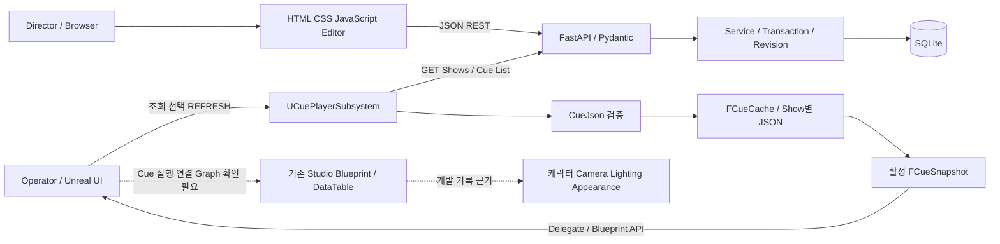

# 실시간 버추얼 퍼포머 연출·공연 운영 시스템 기술 분석

> 발표자료 제작용 근거 문서 · 분석일 2026-11-19 KST
>
> 대상: `C:\Work\Unreal_Engine\MultiProject` / Git HEAD `4ab28a985b13e5b9cd005d9f144f19b8e3f02e5c`
>
> 이 프로젝트는 게임 플레이를 구현하는 프로젝트가 아니라, Unreal Engine의 캐릭터·카메라·무대·조명을 운영자가 실시간 제어하고 웹에서 준비한 공연 순서를 Cue로 운영하는 시스템이다.

## 문서 사용 규칙과 증거 수준

다른 AI는 아래 구분을 슬라이드와 발표 대본에도 유지해야 한다. 커밋 제목의 “Complete”만으로 모든 런타임 기능이 검증됐다고 표현하지 않는다.

| 표기 | 뜻 | 발표 시 허용되는 표현 |
|---|---|---|
| **코드 확인** | 현재 C++/Python/JavaScript 구현을 직접 읽음 | “구현했다.” 단, 테스트 범위는 별도 명시 |
| **테스트 기록 확인** | 보존된 자동 테스트 보고서·로그를 읽음 | “해당 조건의 자동 테스트를 통과했다.” |
| **개발 기록 확인** | 기존 Markdown/PDF에 함수·Graph·흐름이 기록됨 | “개발 기록에서 이 구조를 확인했다.” |
| **에셋 존재 확인** | `.uasset`/`.umap` 경로와 변경 이력만 확인 | “관련 에셋이 있다.” 내부 로직 단정 금지 |
| **현재 Graph 확인 필요** | 현재 Blueprint/Material Graph를 열어 확인하지 못함 | 캡처·실행 검증 후에만 현재 완료 기능으로 확정 |
| **향후 제안/계획** | 기획에 있으나 현재 소스 근거가 없음 | 구현 완료 슬라이드에서 제외 |

이번 분석은 파일·Git·DB 읽기와 문서 작성으로 진행했다. Unreal Editor 실행, 새 빌드, 서버 재시작, 새 테스트 실행, Blueprint/Material 편집은 하지 않았다. 테스트 수치는 **기존 실행 기록**이다. PDF는 텍스트를 추출해 확인했으며 페이지 이미지와 현재 에셋 내부 Graph를 시각 대조한 결과는 아니다.

근거 우선순위는 현재 코드 → 해당 범위의 테스트 기록 → Git 변경 내용 → 개발 기록이다. PDF는 기존 Studio 기능을 설명하는 중요한 자료지만 최신 Cue 연결 상태를 증명하지 않는다.

## 1. 프로젝트 개요 및 목적

### 1.1 해결하려는 운영 문제

버추얼 캐릭터 공연에서는 표정·행동만이 아니라 카메라 구도, 조명 테마, 외형 프리셋, 무대 시점을 함께 조정해야 한다. 프로젝트는 이 연출을 실시간으로 조작하는 Studio와, 공연 순서를 사전에 편집하는 Show/Cue 관리 기능을 결합한다.

기존 [PRD](/C:/Work/Unreal_Engine/MultiProject/docs/PRD.md)는 이를 **연출 준비와 실제 실행을 분리하는 파이프라인**으로 정의한다. Director는 웹에서 목록을 만들고, Operator는 Unreal에서 목록을 명시적으로 선택·갱신한 뒤 실행한다. 두 역할은 한 사람이 맡아도 된다.

### 1.2 제품 범위

- 실시간 Studio: 캐릭터 Animation, Camera, Stage View, Lighting, Appearance, Position, Gesture, Look Tracking 제어. 세부 동작은 PDF 개발 기록 근거이며 현재 Graph 재확인이 필요하다.
- 공연 준비: 웹 Show/Cue CRUD, 복제 초안, 순서 변경, 자동 번호, Revision 저장. 현재 웹·서버 코드로 확인된다.
- Unreal 데이터 연결: HTTP 조회, 엄격한 JSON 검증, Show별 로컬 Snapshot, 비동기 응답 보호, Blueprint API. 현재 C++과 테스트로 확인된다.
- 공연 실행 UI: CURRENT/NEXT, GO, END SHOW, RESET 및 Cue 항목 상태. Widget 에셋과 Git 변경은 확인되지만 현재 전체 실행 Graph는 미열람이다.

발표용 한 문장: **“브라우저에서 공연 순서를 준비하고, Unreal에서 검증된 로컬 Cue 목록을 선택해 캐릭터와 무대 연출을 운영하는 실시간 버추얼 퍼포머 시스템.”**

## 2. 전체 시스템 아키텍처



실선은 현재 텍스트 코드로 확인한 데이터 경로이며 점선은 Blueprint 내부 연결의 현재 상태를 재확인해야 하는 경로다. 웹이 매번 Unreal Actor를 직접 조작하거나 GO 명령을 서버로 보내는 구조는 C++에 없다.

### 2.1 책임 분리

| 계층 | 소유하는 책임 | 관련 파일·타입 |
|---|---|---|
| 웹 | 입력 폼, 선택, 편집 초안, 저장·재조회, 정렬 UI | `CueServer/app/admin/index.html`, `static/admin.js`, `static/admin.css` |
| API/서비스 | 입력 검증, 트랜잭션, ID, 순서, Revision 발행 | `router.py`, `schemas.py`, `service.py` |
| DB | 현재 Show/Cue와 과거 Snapshot 저장 | `models.py`: `Show`, `Cue`, `Revision` |
| Unreal C++ | HTTP 수명, 수신 제한, 파싱, 캐시, 데이터 상태 통지 | `UCuePlayerSubsystem`, `CueJson`, `FCueCache`, `FCueHttpResponseBody` |
| Unreal Blueprint | 운영 UI와 실제 연출 연결 | `WBP_Operator`, `BP_StudioManager`, `BP_BountyHunter` 등 |
| DataTable/Material | 구도·조명·외형의 세부 데이터와 렌더링 | `DT_CameraData`, `DT_LightingData`, Appearance DataTable, Toon Material |

### 2.2 디렉터리 구조

```text
MultiProject/
├─ NetworkProject.uproject       UE 5.8, NetworkProject Runtime 모듈
├─ Source/NetworkProject/
│  ├─ Public/                    CueTypes, CuePlayerSettings, CuePlayerSubsystem
│  └─ Private/                   HTTP, JSON, 캐시 구현 및 Tests/
├─ Content/
│  ├─ Maps/                      Studio.umap, TestMap.umap
│  ├─ Blueprints/
│  │  ├─ Core/                   BP_StudioManager, BP_GameMode
│  │  ├─ Character/              BP_BountyHunter, BP_PlayerController
│  │  ├─ Camera/                 BP_StageCameraAnchor, RT_StudioCamera 등
│  │  ├─ Lighting/               Moving Head / Ceiling Light
│  │  ├─ Stage/                  BP_Stage
│  │  ├─ UI/                     WBP_Operator, WBP_CueItem, WBP_CameraView
│  │  └─ Data/                   Enum, Struct, DataTable
│  └─ ToonShader/                Material, Material Instance, Texture
├─ CueServer/
│  ├─ app/                       FastAPI와 웹 정적 파일
│  ├─ data/cues.sqlite3          기본 DB, CUE_DB_PATH로 대체 가능
│  ├─ examples/cue-list.json     구형 번호를 보존한 계약 테스트 예제
│  └─ tests/                     API, 번호 정책, Stage 테스트
├─ Tests/                       Unreal HTTP fixture, 빌드·테스트 실행 스크립트
├─ Config/                      Studio 기본 맵, 엔진 설정
├─ docs/                        PRD, SDD, 구현 기록, Blueprint 연결 안내
├─ Saved/                       실행 로그, 로컬 Cue 캐시, 자동 테스트 보고서
├─ Image/                       Demo.PNG 등 발표 자료 후보
├─ Texture/                     원본 텍스처·작업 이미지 후보
├─ 내가_한_것들.pdf              87페이지 기존 Studio 개발 기록
└─ Binaries/ Intermediate/ DerivedDataCache/   빌드·중간·캐시 산출물
```

`Config/DefaultEngine.ini`의 기본·Editor 시작 맵은 `/Game/Maps/Studio.Studio`다. 디렉터리명 `NetworkProject`는 모듈 이름이며 멀티플레이 구현의 증거가 아니다.

## 3. 사용 기술과 역할

| 기술 | 실제 역할·근거 | 주장 범위 |
|---|---|---|
| Unreal Engine 5.8 | `.uproject` EngineAssociation, Studio 맵과 런타임 에셋 | 현재 프로젝트 지정 버전 |
| Unreal C++ | `UGameInstanceSubsystem`, `FHttpModule`, JSON, 파일 캐시 | 데이터 연결 기반 |
| Blueprint / UMG | Operator Widget·StudioManager·캐릭터·카메라·조명 에셋 | 에셋·개발 기록 확인, 현재 Graph는 별도 |
| DataTable | 카메라·조명·프리셋·Cue 항목 스타일 데이터 | 에셋 확인, Row 내용은 전체 미검증 |
| Animation Blueprint / Montage / Aim Offset / IK Retargeting | PDF pp.1–11의 캐릭터 애니메이션 구성 | 개발 기록 근거 |
| Dynamic Material Instance / Material Parameter Collection | 외형·무대 색상·Toon 관련 에셋 및 PDF | 상세 셰이더 수식·현재 연결은 미검증 |
| Python / FastAPI | API, 웹 정적 파일, 에러 응답, lifespan | Python 3.11 이상 실행 안내 |
| Pydantic | Literal 상태값, 범위, UUID, extra 금지, camelCase 별칭 | 서버 입력·출력 계약 |
| SQLAlchemy / SQLite | ORM, 관계·UNIQUE 제약, 트랜잭션, Revision | 로컬 영구 저장 |
| HTML / CSS / JavaScript Fetch | 프레임워크 없는 관리 UI, JSON REST 요청 | 실제 소스 확인 |
| pytest / httpx TestClient | 서버 자동 검증 | 보존 로그 37개 통과 |
| Unreal Automation / PowerShell / Python HTTP fixture | C++·캐시·실제 loopback HTTP 검증 | 보존 보고서 7개 통과 |
| Git / Git LFS 설정 | 소스와 바이너리 에셋 개발 이력 | `.gitattributes`의 Content 필터 설정 확인 |

`requirements.txt` 지정값: FastAPI 0.162.5, Pydantic 2.14.3, SQLAlchemy 2.1.8, Uvicorn 0.54.0. 테스트는 httpx 0.28.1, pytest 9.2.0이다. 이는 선언 버전이며 모든 개발 PC의 설치 버전을 뜻하지 않는다.

`.uproject`에는 DMXControlConsole/DMXEngine/DMXFixtures/DMXProtocol과 MCP 관련 플러그인이 활성화되어 있다. **DMX 플러그인 활성화만으로 실제 조명기 하드웨어 제어를 구현했다고 주장할 수 없다.** `RT_StudioCamera`, `WBP_CameraView` 존재만으로 원격 송출·실시간 스트리밍 구현도 확정할 수 없다.

## 4. 구현된 주요 기능과 확인 수준

| 기능 | 관련 클래스·함수·에셋 | 현재 판단 |
|---|---|---|
| Show 생성·이름 수정·삭제·조회 | `service.create_show/rename_show/delete_show/list_shows/show_detail` | 코드·서버 테스트 확인 |
| Cue 생성·수정·삭제·조회 | `create_cue/update_cue/delete_cue/read_cue` | 코드·테스트 확인 |
| Cue 복제 | JS `openDraft(selected)` → 기존 POST 생성 경로 | 별도 clone API가 아닌 복제 초안 |
| 정렬·자동 번호 | JS `reorderCue/insertionOrder/formatNumber`, Python `assign_order/reorder_cues` | 코드·테스트 확인 |
| 변경 Revision·JSON 다운로드 | `publish`, `Revision.snapshot_json`, `download_cue_list` | 코드·테스트 확인 |
| Show 선택·REFRESH·캐시 | `UCuePlayerSubsystem`의 관련 API | 코드·Unreal 테스트 확인 |
| 미선택 시작 | `Initialize`, `RestoreSelectedSnapshot` | C++·회귀 테스트 확인, UI 연결 별도 |
| Stage Cue 전달 | `CueJson::ParseSnapshot`, Pydantic `Camera` | 정확한 문자열 전달 확인 |
| Cue 항목 초기화·상태 설정 API | `AddCueItem`, `InitializeCueItem`, `SetCueItemState` | 리플렉션 테스트로 함수·핀 존재 확인 |
| Animation·Camera·Lighting·Appearance·Position·Gesture | 기존 Studio Blueprint와 PDF | 개발 기록 확인, 현재 Graph 확인 필요 |
| CURRENT/NEXT·GO·END SHOW·RESET | `WBP_Operator` 변경 이력, 최신 커밋 제목, 사용자 설명 | 전체 실행 Graph·씬 통합 테스트는 미확인 |
| Original/Toon 전환 | Appearance Mode Enum, 두 Appearance DataTable, Toon 에셋·Git | 에셋·문서·변경 이력 확인 |

## 5. 기능별 구현 원리와 실행 흐름

### 5.1 기존 캐릭터 Animation과 입력 — 개발 기록 근거

PDF pp.1–11, 18–19, 33–38에는 지속 상태 `Idle/Talk/Dance`를 일회성 Gesture 및 이동 단계와 분리한 구조가 기록되어 있다. `BP_BountyHunter`의 MovementPhase를 Animation Blueprint가 공유해 이동과 애니메이션의 상태 불일치를 줄인다. `GestureSlot` Montage가 기본 상태를 대체하지 않고 일회성 동작을 수행한다. PDF에는 `ABP_BountyHunter`, `RTG_Mannequin_BountyHunter`, `IK_Mannequin`, `IK_BountyHunter`가 명시된다.

기록상 이동 흐름은 실제 Navigation Path의 첫 구간 확인 → 이동 전 회전 → Navigation 이동 → `MoveToExactGoal` 정밀 보정 → 카메라 방향 복귀다. Mesh만 회전할 때 피벗 오프셋으로 원을 그리는 문제를 Actor Rotation 통일로 해결했다고 기록한다. 현재 Graph와 정확한 이동 파라미터는 재확인 대상이다.

### 5.2 Studio Camera와 Stage View — 개발 기록 및 현재 Cue 계약

PDF pp.17–18, 23–24, 42–43에 따르면 일반 카메라는 `DT_CameraData`의 SpringArm 길이·Socket Offset·FOV·Pitch·회전 제한·Focus Socket을 적용한다. Full→pelvis, Upper→spine_04, Close→head 추적과 초기 오프셋의 Component Space 저장, World Space 변환, `VInterpTo` 보간을 설명한다.

Stage View는 일반 Camera State를 보존하면서 카메라를 별도 Stage Anchor에 붙이는 Override로 기록된다. `KeepWorld` Attach와 기존 카메라 Timeline 중단으로 전환 충돌을 방지하고, 종료 시 SpringArm 재부착과 기존 Camera State 재적용을 수행한다고 설명한다. 이 **기존 Studio Timeline**은 현재 범위에서 제외한 **Cue별 cameraBlendMs 실행**과 구분해야 한다.

최신 C++은 `cameraState: "Stage"`를 FName으로 전달한다. 사용자 제공 Blueprint 설명은 `ApplyCueCameraByName(Stage) → SetStageViewOn`, 일반 값은 Resolver 유효성 확인 → `SetStageViewOff → SetCameraButtonState`다. 함수명·연결은 현재 `.uasset` Graph를 직접 읽어 재검증한 것은 아니다.

### 5.3 Lighting — 개발 기록 근거

PDF pp.43, 52–60에는 `BP_StudioManager`가 `DT_LightingData`를 조회해 Character Light, Ceiling Light, Tracking Moving Head, Stage Moving Head, Stage Emissive를 함께 갱신한다고 기록되어 있다. `BP_BountyHunter.ApplyCharacterLighting`, `BP_Stage.ChangeStageLight`, `BP_StudioMovingHead.UpdateTracking`이 관련 함수다.

Moving Head는 spine_04 추적과 Yoke Pan/Head Tilt, 거리 기반 Zoom·Intensity 보정을 설명한다. 같은 Lighting State의 반복 적용을 생략하는 기존 조건도 기록되어 있으므로, Cue RESET에서 강제 재적용이 필요한 경우의 현재 처리 여부를 Graph에서 확인해야 한다. “라이팅 오류 해결” 커밋만으로 해당 원인과 수정 수식을 특정할 수 없다.

### 5.4 Appearance / Toon / 프리셋 — 코드 밖 증거의 범위

PDF pp.20, 28–29, 41, 44, 61–68, 87은 BeginPlay에서 Dynamic Material Instance를 캐시하고 Hair/Clothes/Eye/Lip/Skin 파라미터를 적용하는 구조를 설명한다. `BP_StudioManager`는 데이터 선택, `BP_BountyHunter`는 실제 Material Parameter 적용을 맡는다.

`MatchPresetState`는 마지막으로 누른 버튼 대신 실제 Character/Camera/Lighting 조합을 `DT_PresetData`와 비교해 Built-in Preset 또는 Custom을 판정한다고 기록한다. Appearance는 그 연출 조합 판정에서 분리된다.

Original/Toon Appearance DataTable과 `M_Toon`, `M_Outline`, `MPC_Toon`, SDF 좌우 텍스처가 존재한다. Git에는 Outline, Hair Anisotropic Specular, SDF, Rim Light 작업 기록이 있다. 현재 Material Graph를 열지 않았으므로 정확한 셰이딩 공식, 패스 구성, 성능 개선 수치는 주장하지 않는다. Cue v2에 Shader Mode가 없는 것은 현재 서버와 C++ 코드로 확정할 수 있다.

### 5.5 웹 편집 상태와 오류 복구 — 코드 확인

`admin.js`의 `dirty/busy/reloadTarget`은 미저장 변경, 요청 중 조작, 저장 성공 후 재조회 실패를 구분한다. `allowLeave()`는 저장/버리기/취소를 제공하고 `beforeunload`로 이탈을 경고한다. `saveAndReload()`는 저장 후 서버 상태를 다시 읽는다. 저장은 성공했으나 목록 조회가 실패한 경우 이를 별도 메시지로 알린다.

`renderCueErrors()`는 서버 `fieldErrors`를 필드별로 표시한다. `renderList()`는 `textContent`로 Cue 정보를 표시한다. Drag/Drop과 위/아래 버튼은 `reorderCue()`를 공유하며 서버 확인 후 목록을 갱신한다. 웹의 `load()`는 일치하는 Show가 없으면 `list[0]`을 고를 수 있다. **웹 편집기의 기본 선택과 Unreal의 미선택 Play 정책은 서로 다르다.**

## 6. Web / Server / Unreal 데이터 전달 구조

### 6.1 현재 REST API

기준 라우터는 `CueServer/app/cues/router.py`, prefix는 `/api/v1/shows`다.

| 요청 | 용도 |
|---|---|
| GET / POST `/api/v1/shows` | Show 목록 / 생성 |
| GET / PATCH / DELETE `/api/v1/shows/{show_id}` | 상세 / 이름 수정 / soft delete |
| POST `/api/v1/shows/{show_id}/cues` | Cue 생성 |
| GET / PATCH / DELETE `/api/v1/shows/{show_id}/cues/{cue_id}` | Cue 조회 / 부분 수정 / 삭제 |
| PUT `/api/v1/shows/{show_id}/cue-order` | 전체 Cue UUID 순열로 정렬 |
| GET `/api/v1/shows/{show_id}/cue-list` | 현재 발행된 Snapshot JSON |

현재 Unreal C++은 GET 목록과 GET cue-list만 요청한다. Show/Cue 편집·DB 쓰기는 웹/서버 책임이다. 서버 `download_cue_list()`는 저장된 `snapshot_json`을 `Cache-Control: no-store`로 그대로 반환한다. 별도 publish 버튼 없이 수정 트랜잭션마다 Revision이 발행된다.

### 6.2 v2 데이터 계약

아래는 설명용 예시이며 실제 운영 Show/UUID를 복사한 데이터가 아니다.

```json
{
  "schemaVersion": 2,
  "showId": "00000000-0000-0000-0000-000000000001",
  "showName": "Presentation Demo",
  "revision": 2,
  "publishedAt": "2026-11-19T00:00:00Z",
  "cues": [{
    "id": "00000000-0000-0000-0000-000000000002",
    "position": 1,
    "number": 1,
    "name": "Opening",
    "animationState": "Idle",
    "cameraState": "Stage",
    "lightingState": "Stage",
    "appearancePreset": "Preset_01",
    "cameraBlendMs": 0,
    "lightingFadeMs": 0
  }]
}
```

| 필드/조건 | 현재 계약과 근거 |
|---|---|
| UUID | Show/Cue의 안정 식별자. Unreal `NormalizeShowId`는 하이픈 UUID를 소문자 정규화 |
| Position / Number | 현재 서버는 `number = position`, 1부터 연속. 실행 배열 순서는 Position. C++은 과거 Snapshot의 독립된 Number도 허용 |
| Animation | Idle / Talk / Dance |
| Camera | Full / Upper / Close / Stage. Stage는 별도 Override 토큰 |
| Lighting | Neutral / Focus / Stage. Camera의 Stage와 별도 필드 |
| Appearance | Preset_01–Preset_05. Material 세부 값 대신 참조 |
| 시간 필드 | 0–30000ms 호환 데이터. 생성 생략 시 0, 수정 생략 시 기존 값 유지. 웹 입력 UI와 지정 시간 실행은 제외 |
| 목록/버전/크기 | Cue 최대 1000, schemaVersion 정확히 2, Unreal 응답 최대 4 MiB |
| 날짜·정수·필드 | timezone 포함 날짜, 정수 엄격 검증, 누락·알 수 없는 필드·중복 ID/번호·비연속 Position 거부 |

Pydantic `to_camel`은 `camera_state` 같은 Python 속성을 JSON `cameraState`로 변환한다. 상태 문자열 자체는 변환하지 않는다. Unreal `State()`는 대소문자를 구분해 비교한 뒤 `FName`으로 저장한다. `stage`는 `Stage`와 달리 거부된다.

### 6.3 DB 구조와 관찰

`models.py`의 `Show/Cue/Revision`은 각각 `shows/cues/revisions` 테이블에 매핑된다.

- Show: id PK, name, current_revision, created_at, updated_at, deleted_at.
- Cue: id PK, show_id FK, position, number, name, 네 연출 값, 두 시간 값. `(show_id, position)`, `(show_id, number)`가 각각 UNIQUE다.
- Revision: `(show_id, revision)` 복합 PK, created_at, snapshot_json, is_deleted.

Show는 soft delete하며 tombstone Revision을 남긴다. Cue 삭제는 실제 Cue 행 삭제 후 나머지 순서를 재정리한다. 외래키는 `database.build_engine()`의 SQLite connect 이벤트에서 활성화한다.

분석 시 기본 `CueServer/data/cues.sqlite3`을 **mode=ro**로 읽은 결과: shows 1행, cues 4행, revisions 14행, Camera 값은 Full 2 / Upper 1 / Stage 1이었다. 이는 해당 파일의 당시 관찰값이며 Close 미지원이나 운영 서버 전체 Show 개수를 뜻하지 않는다. 서버가 `CUE_DB_PATH`로 다른 DB를 사용할 수 있다. 운영 DB에는 쓰지 않았다.

## 7. Show / Cue 생성·저장·조회·실행 과정

### 7.1 생성·수정·발행

1. 웹 `saveCue()`가 `cuePayload()`의 FormData로 POST/PATCH를 보낸다. Number는 입력하지 않는다.
2. FastAPI가 `CueFields/CuePatch`로 검증한다. unknown field, 잘못된 상태, null, 범위 초과는 422다.
3. `service.write()`가 `BEGIN IMMEDIATE`를 시작한다. `create_cue()`는 UUID와 마지막 Position을 부여하고 `update_cue()`는 전달된 필드만 변경한다.
4. `publish()`가 Revision을 증가시키고 전체 순서의 Cue를 `CueList`로 직렬화한다.
5. DB 커밋 후 응답한다. 예외 시 `database.get_session()`이 rollback한다.
6. 웹 `saveAndReload()`가 최신 Show와 Cue를 다시 표시한다.

### 7.2 정렬·삭제·복제

`reorder_cues()`는 요청 UUID가 해당 Show의 모든 Cue를 정확히 한 번 포함하는지 확인한다. `assign_order()`는 이동 대상의 Position과 Number를 임시 음수로 옮겨 flush한 뒤 양수 연속 번호를 확정한다. 이 방식은 두 UNIQUE 열의 교환 충돌을 피한다. 삭제도 동일 재번호화 경로를 사용한다.

복제는 `openDraft(source)`에서 원본 연출 및 숨긴 시간 값을 초안으로 만들고, 저장 시 기존 생성 API로 새 UUID·마지막 번호를 받는다. 번호는 `formatNumber()`의 `padStart(3, "0")`로 001부터 표시하며 1000 이상을 자르지 않는다.

### 7.3 Unreal 조회·활성화

```text
RequestShows → HandleShowsResponse → ParseShows → OnShowsReceived
운영자 SelectShow(UUID) → 선택 저장 → 기존 요청 취소 → 해당 Show 캐시 조회
REFRESH → 비동기 GET cue-list → 응답 제한/상태 확인 → ParseSnapshot
 → SaveSnapshot 성공 → ActiveSnapshot 교체 → OnSnapshotChanged
 → OnRefreshCompleted → OnStatusChanged
```

`SelectShow()` 자체는 HTTP 다운로드를 수행하지 않는다. 캐시가 없으면 빈 Snapshot을 알린다. 수동 선택 직후 서버 목록을 보여주는 UI라면 Blueprint에서 기존 REFRESH 경로를 이어야 한다. Request 함수의 bool은 “요청 시작”이지 다운로드 성공이 아니다.

`HandleCueResponse()`는 HTTP 수신·파싱·디스크 저장이 모두 성공한 경우에만 활성 Snapshot을 바꾼다. 같은 Show의 REFRESH 실패는 기존 정상 데이터·성공 시각을 보존한다. Show 전환 때는 이전 Show의 목록을 새 Show처럼 사용하지 않도록 먼저 비운다.

### 7.4 GO·END SHOW·RESET의 확인 경계

C++ `UCuePlayerSubsystem`은 GO/END SHOW/RESET 실행 커서나 씬 명령을 구현하지 않는다. 이 기능의 현재 실체는 `WBP_Operator`/Studio Blueprint에 있다. Git 최신 커밋은 Cue playback 완료를 기록하지만 binary diff만으로 다음 사항은 확정할 수 없다.

- GO가 어느 시점에 Running/Applied를 변경하는지, 실제 완료를 기다리는지.
- END SHOW가 타임라인·Montage·입력·음악을 어떻게 정리하는지.
- RESET이 Shader Mode를 보존하고 동일 Lighting State를 강제 재적용하는지.
- 실행 중 REFRESH 잠금·연속 GO 방지·마지막 Cue 종료 조건이 완결되는지.

발표에서는 “운영 UI 기반 로컬 실행 구조”로 설명하고, 완료 동작은 현재 Graph 캡처와 실제 시연 영상으로 보강한다. PRD의 STOP과 현재 사용자가 부르는 END SHOW를 검증 없이 같은 의미로 치환하지 않는다.

## 8. 로컬 캐시 및 초기화 구조

### 8.1 파일과 원자적 저장

`FCueCache`는 `Saved/CuePlayer/{normalized-show-uuid}.json`에 `cacheVersion:1`, `lastSuccessfulRefreshUtc`, 원본 Snapshot을 감싼 envelope를 저장한다. `selection.json`에는 선택 UUID가 별도로 저장된다.

내부 `AtomicWrite()`는 동일 디렉터리의 UUID 임시 파일에 UTF-8 JSON 기록 → `Flush(true)` → Win64 `MoveFileExW(REPLACE_EXISTING | WRITE_THROUGH)`로 교체한다. 기존 정상 파일을 먼저 삭제하지 않는다. 실패하면 임시 파일을 정리하고 정상 파일을 유지한다. **현재 원자 교체 구현은 Win64에 한정**되어 있으며 다른 OS의 성공 경로는 구현되어 있지 않다.

저장과 복원 모두 `CueJson::ParseSnapshot()`을 사용한다. 캐시 envelope 버전·UTC 시각·크기도 검증한다. 손상 파일을 단순히 신뢰해 UI로 보내지 않는다.

### 8.2 Play 초기화 정책

현재 `Initialize()`는 캐시 디렉터리만 설정한다. HTTP, 저장된 Show 선택 복원, Snapshot 자동 표시, 씬 명령을 실행하지 않는다. `RestoreSelectedSnapshot()`은 현재 선택 ID가 비면 오류를 반환하고 selection.json에서 ID를 가져오지 않는다. 명시적 `SelectShow()` 이후에는 캐시가 계속 사용된다.

초기 UI 목표는 Show=Select Show / 빈 Cue List / CURRENT=STANDBY / NEXT=NONE / GO=GO --- 비활성 / REFRESH 활성 / Cue RESET 비활성이다. 이 텍스트·버튼 상태는 C++ DTO가 아니라 Blueprint UI 책임이다. [CueStartupBlueprint](/C:/Work/Unreal_Engine/MultiProject/docs/CueStartupBlueprint.md)는 연결 지침이며 현재 Widget Graph가 모두 그대로 적용됐다는 증거는 아니다.

`RequestShows()`는 첫 Show를 선택하지 않는다. Blueprint의 옵션 채우기·선택 이벤트에서도 자동 SelectShow를 막아야 한다. 미선택 REFRESH는 Blueprint에서 RequestShows로, 선택된 상태의 REFRESH는 기존 RefreshCueList로 보내는 안내가 있다. C++ RefreshCueList 자체는 미선택일 때 실패를 반환한다.

### 8.3 비동기 수명 보호

`ShowsGeneration/CueGeneration`, 요청 포인터, 선택 Show ID, Base URL, `bShuttingDown`을 검사한다. 취소 시 Generation 증가·delegate Unbind·요청 Cancel을 수행한다. 새 요청 뒤에 도착한 이전 응답이나 다른 Show의 응답이 현재 목록을 덮어쓰는 것을 차단한다.

HTTP 수신 스트림은 별도 공유 `FCueHttpResponseBody`에 저장하고 `FCriticalSection/FScopeLock`으로 스레드 접근을 보호한다. 4 MiB를 초과하는 청크는 버퍼에 추가하지 않고 Length=0으로 중단한다. 완료 delegate는 Game Thread 정책이다. Blueprint broadcast 전에 복사본을 만들어 동기 재진입 중 상태 변경의 영향을 줄인다.

## 9. 주요 기술적 문제와 해결

| 문제 | 원인·해결·근거 | 증거 수준 |
|---|---|---|
| Stage Cue가 포함되면 전체 목록 거부 | 서버는 Stage 허용, C++ Camera allowlist는 누락. `CueJson.cpp` `State()`가 Unsupported 오류, ParseSnapshot이 Cue 위치를 붙여 전체 거부. Camera allowlist에 Stage만 추가, Enum 추가 없음 | 코드·RED/GREEN 기록 |
| Show 전환 후 빈 목록 | SelectShow가 이전 목록 초기화 후 새 캐시를 검증. Stage 검증이 캐시와 REFRESH 모두 실패시키면 빈 상태 유지. REFRESH 실패 자체가 기존 목록을 삭제하는 것은 아님 | 코드·테스트 |
| Play 시작 시 이전 Show 노출 | Initialize의 자동 Restore와 Restore 내부 저장 ID 읽기 제거. 수동 선택 후 캐시 경로 유지 | 코드·초기화 RED/GREEN |
| 정렬 시 Position/Number UNIQUE 충돌 위험 | 임시 음수 배치·flush 후 최종 연속 번호, 발행까지 하나의 트랜잭션 | service.py·번호 테스트 |
| 저장 실패·불량 JSON으로 정상 목록 손실 | 임시 Parsed 후 전체 성공 시 대입, 캐시 원자 교체 성공 후 활성화 | C++·캐시/HTTP 테스트 |
| 늦은 응답이 최신 Show를 덮어씀 | Generation·요청·Show·URL 검증과 취소 | HTTP 자동 테스트 |
| 기존 데이터 전환 시 이력 손실 위험 | v1 Shader 제거→v2 검증·변환, 현재 번호 재지정과 새 Revision 발행을 트랜잭션 처리. 과거 v2 이력은 보존, 반복 실행 시 불필요한 추가 발행 방지 | migrations.py·테스트 |
| Camera Tracking 좌표계·초기 오프셋 불일치 | Component Space 기준 오프셋 보존 후 World 변환·보간 | PDF p.17, 현재 Graph 확인 필요 |
| 일반 Camera와 Stage Timeline 동시 쓰기 | 전환 시 기존 Timeline 중단, Attach 기준 관리, 일반 State 보존 | PDF pp.18,43 |
| Mesh 회전 피벗으로 인한 이동 이상 | Mesh 단독 회전 대신 Actor 회전 기준 통일 | PDF p.18 |
| 화면 Preset이 실제 상태와 불일치 | `MatchPresetState`로 실제 세 상태 조합 비교, Custom 재판정 | PDF p.41 |

Stage 수정 전 보고서에서 CameraContract와 HttpContract가 실패하고 수정 후 통과했다. 초기화 수정 전에는 HttpContract의 미선택·빈 Snapshot 기대가 실패했으며 수정 후 통과했다. 이 두 사례는 발표에서 원인→최소 수정→회귀 검증을 코드와 함께 보여주기 좋다.

## 10. 테스트 및 검증 결과

### 10.1 보존된 Unreal 실행 기록

| 기록 | 성공 집계 | 의미 |
|---|---|---|
| `stage-red-report/index.json` | 5 성공 / 2 실패 | Stage 허용 전 파서·HTTP 재현 |
| `stage-green-report/index.json` | 6 성공 + 경고 포함 1 성공 / 실패 0 / 미실행 0 | Stage 수정 후 7개 통과 |
| `startup-red-report/index.json` | 6 성공 / 1 실패 | 초기 자동 복원 재현 |
| `startup-green-report/index.json` | 6 성공 + 경고 포함 1 성공 / 실패 0 / 미실행 0 | 초기화 수정 후 7개 통과 |

경로 기준은 `Saved/CueImplementation/`다. JSON의 시간 문자열에는 timezone 표기가 없어 임의로 KST로 해석하지 않았다. `build-startup-green-console.log`와 `build-stage-green-console.log`는 Development Editor Win64 증분 빌드 성공 기록이다. 이번 문서 작성 중 다시 빌드한 것은 아니다.

| 테스트 이름 | 검증 내용 / 한계 |
|---|---|
| NetworkProject.Cue.BlueprintSurface | C++ UFunction과 `AddCueItem/InitializeCueItem/SetCueItemState` 핀 리플렉션. Graph 실행·UI 모양 테스트 아님 |
| CacheContract | 캐시 저장·재시작 복원·손상·경로 검증·파일 잠금 교체 실패 후 정상본 유지 |
| CameraContract | Full/Upper/Close/Stage 수용, 문자열 보존, Wide·잘못된 대소문자·빈 값 거부 |
| HttpContract | 실제 loopback HTTP, REFRESH, Stage 캐시, Show 반복 전환, HTTP 오류·시간초과·초과 크기, 오래된 응답, 미선택 시작과 직접 선택 복원 |
| JsonContract | v2·Cue 순서·필드·타입·범위·UUID·중복·빈 Show·실패 원자성 |
| ResponseLimit | 수신 버퍼 크기와 청크 제한 |
| UnicodeTimestamp | Unicode codepoint 이름 길이, timezone 오프셋·날짜·잘못된 형식 |

HttpContract의 경고는 의도적 대용량 응답 차단과 timeout 실패 경로에서 발생한다. 경고 포함 성공 1개를 “경고 없는 전체 성공”으로 표현하지 않는다.

### 10.2 서버 테스트

`Saved/CueStageFix/server-tests.log`: **37 passed, 1 warning in 5.88s**. 경고는 Starlette TestClient의 httpx 사용 deprecation이다. 테스트마다 임시 SQLite DB를 사용한다.

- `test_api.py`: CRUD·soft delete 이력, 재시작, 잘못된 입력, Revision 저장 실패 롤백, 동시 쓰기, 정적 관리자/OpenAPI, 구형 DB 전환과 실패 보존.
- `test_numbering.py`: 생성·정렬·삭제 후 번호, 출력 전용 Number, 새 UUID 복제, 마이그레이션 이력·반복 실행·실패 롤백, number=1000.
- `test_stage.py`: 네 Camera 값의 생성·수정·조회·다운로드, Stage·시간 값·재정렬·재시작 보존, OpenAPI 계약.

### 10.3 입증하지 못한 항목

실제 Studio 맵의 GO/END SHOW/RESET 통합 동작, Stage Override의 화면 전환, 현재 Widget 버튼 상태, 셰이더 비교 품질, 프레임레이트·GPU 비용·장시간 안정성·네트워크 지연 성능은 위 자동 테스트로 입증되지 않는다. 웹 UI는 API/정적 파일 테스트와 코드 분석을 확인했으며, 이번 분석에서 브라우저 E2E를 새로 실행하지 않았다. CUE_DB_PATH에 지정된 실제 운영 서버와 기본 DB가 같은지 확인하지 않았다.

재현 도구는 `Tests/run_cue_tests.ps1`, `Tests/cue_http_fixture.py`, `CueServer/requirements-test.txt`다. 스크립트는 기본적으로 빌드와 UnrealEditor-Cmd를 실행하므로 발표 직전 재실행은 Editor 저장·종료와 시간을 확보한 뒤 수행한다.

## 11. 기존 프로젝트에서 추가·개선된 기능과 Git 이력

분석 시작 시 작업 트리는 깨끗했다. 현재 HEAD는 `4ab28a9`이며 이전 작업의 Stage·초기화 변경이 이미 커밋되어 있다. 바이너리 에셋 변경은 존재만 확정하고 내부 의미는 커밋 제목과 구분한다.

| 커밋·일자 | 실제 변경 근거 | 발표 해석 |
|---|---|---|
| `0a5f2db` 11/06, `6c2c48f` 11/11, `23dc106` 11/16, `16f7e24` 11/16 | 제목에 Outline, Hair Anisotropic Specular, SDF, Rim Light 기록 | 렌더링 발전 과정의 이력. 현재 수식·품질은 별도 증거 |
| `b9fd91e` 11/17 | Cue 도입 전 체크포인트 | 비교 기준 커밋 |
| `fa3b5f2` 11/17 | 웹서버·Toon 전환 작업 기록 | 웹/서버 확장 시기 |
| `67e63ad` 11/17 | StudioManager·캐릭터·Toon·Lighting DataTable·Studio 맵 등 변경 | Studio 렌더링과 외형/조명 연동 개선 이력 |
| `41b1462` 11/18 | 캐릭터·MovingHead·Material Instance binary 변경, 제목 “라이팅 오류 해결” | 해결 사실의 개발 이력. 정확한 버그 원인은 미확정 |
| `b58d86e` 11/18 | Cue Control UI와 DataTable 스타일 기록 | 운영 목록 UI 기반 추가 |
| `6df154e` 11/18 | C++ Runtime 모듈·Subsystem·HTTP·JSON·캐시·테스트 코드 추가 | 기존 Studio 위에 데이터 연결 계층 추가 |
| `5e17560` 11/19 | Operator Widget 등 binary 변경, 선택·REFRESH·복원 통합 제목 | Blueprint 연동 작업 기록 |
| `16c9bef` 11/19 | 서버 자동 번호·Stage·웹 UI·테스트·관련 에셋 변경 | 편집과 데이터 계약 개선 |
| `4ab28a9` 11/19 | C++ Stage 허용, 초기 자동 복원 제거, 회귀 테스트, StudioManager/Operator binary 변경 | 현재 데이터 계층 개선 확정. 실행 완결성은 Graph/영상 필요 |

`git diff b9fd91e HEAD --numstat -- Source CueServer`에서 현재 C++ 데이터 기반과 CueServer 파일이 해당 체크포인트 이후 추가된 것을 확인했다. 기존 캐릭터·카메라·무대 시스템을 새로 전부 C++로 재구현한 프로젝트라고 설명하면 부정확하다.

기존 PRD/SDD/ImplementationPlan에는 C++ 기반 단계의 “GO는 다음 단계”, Stage 웹 작업 당시의 “C++ Stage 미지원” 설명이 남아 있다. 현재 Stage 파싱과 초기화는 실제 코드를 우선한다. GO 상태는 최신 binary 변경으로 진전이 기록되어 있으나 현재 Graph 미확인이므로 과거 문서를 근거로 무조건 미구현이라고 단정하지도 않는다.

## 12. 기술적 강점과 한계

### 강점

1. **준비·운영 분리:** 웹에서 편집한 구성은 Unreal의 명시적 REFRESH 시점에 활성화된다. 공연 중 웹 편집이 곧바로 씬을 바꾸는 결합을 피한다.
2. **세부 연출 자산 재사용:** Cue가 Transform/Material 값을 중복 저장하지 않고 기존 상태·Preset 참조를 전달한다.
3. **실패 원자성:** 서버 트랜잭션, JSON 전체 검증, 디스크 원자 교체, 성공 후 Snapshot 활성화로 일관성을 유지한다.
4. **수명·비동기 안전성:** 취소·Show 전환·새 요청 이후 오래된 콜백을 차단한다.
5. **운영 통제:** 미선택 시작과 직접 선택 정책, 요청 상태와 로컬 가용성 분리로 운영자가 어떤 데이터를 쓸지 결정한다.
6. **회귀 검증 근거:** Stage·초기화 문제를 실제 실패로 재현한 뒤 통과시킨 기록이 있다.
7. **기존 Studio의 책임 분리:** PDF의 지속 상태/이동/Gesture 분리, DataTable, 실제 상태 기반 Preset 판정은 발표할 가치가 높은 설계다. 현재 Graph로 보강해야 한다.

### 한계

- 현재 서버 코드에 사용자 인증·권한 관리·앱 차원의 HTTPS 설정이 없다. Director/Operator는 역할 개념이며 접근권한 구현이 아니다.
- Revision 이력은 있으나 편집 충돌 방지 `If-Match`·ETag·304 처리와 웹 이력 복구 UI는 확인되지 않는다.
- SQLite 쓰기는 직렬화하지만 이것이 여러 편집자의 stale 상태 덮어쓰기를 방지하는 것은 아니다.
- Windows 캐시 교체 구현에 의존한다. 패키징 빌드·다른 OS 검증은 보존 기록으로 확인하지 못했다.
- 자동 데이터 테스트가 씬 완료·중단·모든 UI 상태 전이를 보장하지 않는다. `bCanUseLocalSnapshot`은 데이터 유무이지 GO 허가가 아니다.
- 자동 폴링·WebSocket 실시간 동기화는 없으며 의도적으로 선택·REFRESH를 사용한다.
- 대규모 공연/장시간 운용/지연·메모리·GPU 성능 수치가 없다. “방송급 무중단”, “60fps 보장”, “하드웨어 DMX 제어 완료” 같은 표현은 근거 부족이다.

## 13. 향후 개선 방향 — 구현 완료 항목 아님

| 순위 | 제안 | 필요한 이유·완료 증거 |
|---|---|---|
| 1 | 현재 BP 실행 Graph·통합 시연 검증 | GO/END/RESET·Stage·초기 UI·연속 클릭·실행 중 REFRESH를 영상과 테스트로 확정 |
| 2 | 문서와 현재 구현 상태 정합성 정리 | 과거 자동 복원·Stage 미지원·STOP 용어 설명의 적용 시점 명시 |
| 3 | 실행 완료·취소·늦은 완료 이벤트 보호 점검 | PRD의 RunId/MANUAL OVERRIDE 요구와 현재 BP 비교 후 필요한 부분만 구현 |
| 4 | 인증·권한·네트워크 배포 구성 | 외부 기기 운영 시 변경 권한과 접근 범위 확보 |
| 5 | 낙관적 동시 편집 제어 | Revision 기반 If-Match, 충돌 재조회·재적용 UI |
| 6 | 운영 백업·이력 조회·복구 | Revision 저장과 사용자 복구 기능은 별개 |
| 7 | 패키징·장시간 리허설·성능 계측 | 데이터 처리 지연, 메모리, GPU 프레임시간의 실제 수치 확보 |
| 선택 | 플랫폼별 캐시 교체 구현 | Win64 외 배포가 필요할 때만 추가 |
| 별도 범위 | Cue별 Camera Blend / Lighting Fade | 호환 시간 필드는 있지만 지정 시간 실행은 현재 범위 제외. 기존 Studio Timeline 제거와 혼동 금지 |
| 별도 범위 | 방송 송출·원격 영상 모니터링 | 현재 C++/서버 코드에서 완료 근거 없음 |

## 14. 발표에서 강조할 기술적 성과

| 핵심 메시지 | 보여줄 근거 | 피해야 할 과장 |
|---|---|---|
| “단일 캐릭터 조작을 공연 구성·운영 파이프라인으로 확장” | 웹 Editor → Snapshot JSON → Unreal 운영 UI | 전체 기능을 C++로 새로 만들었다는 설명 |
| “동일한 ID와 데이터 계약으로 웹·서버·Unreal 연결” | UUID, schemaVersion 2, `CueFields`와 `FCueData` 비교 | 웹이 Actor Transform을 직접 제어한다는 설명 |
| “정상 목록을 지키는 갱신 구조” | 임시 파싱·트랜잭션·원자 캐시·실패 테스트 | 모든 장애에서도 공연이 무조건 계속된다는 보장 |
| “Stage를 기존 카메라 Enum과 분리해 호환성 유지” | ParseSnapshot 한 줄과 Stage 분기 Graph | E_CameraState에 Stage 추가했다고 설명 |
| “운영자가 선택하기 전에는 공연 목록을 노출하지 않음” | Initialize/Restore 변경, startup RED/GREEN, 초기 UI 캡처 | C++만으로 모든 Widget 표시가 완성됐다는 설명 |
| “연출 State와 UI 피드백의 일관성” | PDF의 MatchPresetState와 현재 Graph·시연 | 아직 확보하지 않은 완료·취소 동작을 검증했다고 설명 |

추천 발표 흐름은 목적 → 기존 Studio → 웹 편집 → 데이터 전달 → Unreal 운영 → 두 가지 트러블슈팅 → 테스트·한계 → 확장 방향이다. 렌더링은 결과 화면과 Material Graph가 확보된 수준에 맞춰 비중을 조절한다. 특정 상용 제품과 성능·기능 동급이라고 비교하지 않는다.

## 15. Screenshot 및 시연 영상 추천

아래는 **추천 촬영 목록**이다. 이번 문서 작업에서 새 화면이나 영상을 촬영한 것은 아니다. UI·Graph를 실제 확인한 뒤 사용하고 각 컷에 촬영일·커밋을 남긴다.

### 15.1 스크린샷

| ID | 화면·대상 | 강조점 / 촬영 조건 |
|---|---|---|
| S01 | Studio 전체와 캐릭터·무대·Operator | 게임 HUD 대신 공연 운영 환경임을 한 컷으로 설명 |
| S02 | 웹 Show 선택·Cue 목록·Inspector | 001 번호, 네 연출 필드, Stage 선택지, Revision이 함께 보이게 |
| S03 | 웹 편집과 Unreal 목록의 같은 Cue | Show UUID/Revision/번호/이름을 맞춰 전달 일관성 설명 |
| S04 | Stage Cue 포함 v2 JSON | cameraState/lightingState의 Stage 차이, Preset 참조 표시 |
| S05 | Play 직후 미선택 초기 UI | Select Show, STANDBY, NONE, GO --- 비활성, REFRESH 활성, RESET 비활성 |
| S06 | 일반 Camera와 Stage View 같은 장면 비교 | Full/Upper/Close와 별도 Stage Override의 범위 차이 |
| S07 | Original/Toon 동일 포즈·카메라 비교 | 조명·프리셋·노출 조건을 맞추고 렌더링 결과 설명 |
| S08 | `DT_CameraData`, `DT_LightingData`, Appearance DataTable | 세부 값과 Cue 참조 분리. 행 이름/컬럼이 읽히게 |
| S09 | `ApplyCueCameraByName`와 StartNextCue 검증 분기 | Stage 예외가 Enum 확장 없이 연결되는 실제 Graph |
| S10 | `MatchPresetState` 및 UI 갱신 | 마지막 클릭이 아닌 실제 조합 판정 |
| S11 | Unreal startup-green 보고서·서버 테스트 로그 | 7개 성공, 서버 37개 성공, 경고와 범위도 표기 |
| S12 | Stage 실패·수정 전후 코드와 결과 | Unsupported 원인과 최소 수정·회귀 검증 연결 |
| S13 | 필요한 Toon Material Graph 부분 | 전체 난독 Graph 대신 SDF/Outline 등 실제 설명할 부분만 캡처 |

기존 `Image/Demo.PNG`와 `Texture/`의 이미지들은 자료 후보로 존재한다. 내용·현재 버전 일치 여부·사용권을 이번 분석에서 시각 검증하지 않았으므로 확인 후 채택한다. 직접 촬영한 최신 Studio 화면을 우선 추천한다.

### 15.2 시연 영상

| ID | 제안 분량 | 시나리오·성공 확인 |
|---|---|---|
| V01 | 60–90초 | 웹 Show/Cue 편집 → 정렬·001 재번호 → Unreal 직접 Show 선택·REFRESH → 같은 목록 확인 → GO. 새 변경은 REFRESH 후 반영됨을 보여줌 |
| V02 | 20–30초 | 캐시가 있는 상태에서 Stop→Play → 미선택 화면 유지 → 직접 선택 후 복원. BP 정책 적용을 검증 |
| V03 | 30–45초 | Stage Cue 실행 → 다음 Full/Upper/Close 실행 → Stage Override 해제·일반 구도 복귀. CURRENT/NEXT도 함께 촬영 |
| V04 | 30–45초 | 정상 Snapshot 확보 → 서버 중지 또는 테스트용 실패 → REFRESH 오류와 기존 목록 유지. “실제 GO 지속”은 직접 성공을 확인한 경우에만 포함 |
| V05 | 30–45초 | GO 연속 실행, 마지막 Cue, END SHOW, RESET 및 다시 시작. 실제 상태·잠금·씬 정리가 확인되어야 사용 |
| V06 | 30–45초 | 수동 Character/Camera/Lighting 변경 → Preset/Custom 재판정 → Appearance만 변경 시 연출 Preset 유지 |
| V07 | 30–45초 | 동일 구도 Original/Toon, Moving Head 추적, Position 이동·도착, Gesture 복귀. 각 동작은 현재 Graph·화면에서 검증 후 포함 |

영상 준비 시 운영 DB를 초기화하지 않는다. 별도 시연 Show를 쓰고 ID·Revision을 기록한다. 오류 시연은 안전한 테스트 환경에서 진행하며 발표용 정상 Show를 손상시키지 않는다. 본 문서는 촬영 제안이지 실행·데이터 변경 지시가 아니다.

## 부록 A. 현재 Blueprint 확인·캡처 요청 목록

기존 PDF에는 상세한 Graph 설명이 있지만 최신 Cue 연결이 모두 포함되어 있지 않다. 현재 Editor에서 아래 부분을 읽기 전용으로 확인하면 발표의 미확정 항목을 줄일 수 있다.

| 대상 | 함수·Graph 또는 확인할 연결 | 확인 질문 |
|---|---|---|
| WBP_Operator | Event On Initialized/Construct, Show ComboBox 이벤트, OnShowsReceived | 이전 ID·첫 옵션 자동 선택이 없는가? 목록 갱신 Direct 이벤트를 차단하는가? |
| WBP_Operator | OnSnapshotChanged, 목록 재생성, AddCueItem | HasSnapshot false·빈 배열·Show 전환을 올바르게 처리하는가? |
| WBP_Operator | StartNextCue, ApplyCueCameraByName, ResolveCueCameraState | Stage 유효성 OR 조건, SetStageViewOn/Off, 기존 Camera 적용 순서 |
| WBP_Operator | GO/END SHOW/Cue RESET 버튼 이벤트와 상태 갱신 함수 | 연속 GO, 마지막 Cue, 실행 잠금, CURRENT/NEXT, Shader Mode 보존 |
| WBP_CueItem | InitializeCueItem, SetCueItemState, 스타일 Row 조회 | Pending/Next/Running/Applied 및 종료 상태의 실제 Enum 값·색상 |
| BP_StudioManager | SetStageView, UpdateCameraState, MatchPresetState, UpdateLightingState | Attach/Detach, Timeline 중단, 조합 판정, 같은 Lighting 재적용 조건 |
| BP_StudioManager | Appearance 모드·Preset 적용 Graph | Original/Toon DataTable 선택과 현재 모드 유지 |
| BP_BountyHunter | ApplyCameraState, Camera tracking, 이동·보정 Timeline, ApplyCharacterLighting | 초기 오프셋·좌표계, 실제 파라미터 적용·중단 동작 |
| BP_PlayerController | 입력 이벤트, RequestViewportClick, Look Tracking, Camera Orbit | UI와 3D 입력 충돌 방지·Stage 중 Tracking 제한 |
| ABP_BountyHunter | StateMachine, Locomotion, GestureSlot, Aim Offset | 지속 State·이동·일회성 Action 합성 |
| MovingHead / BP_Stage | UpdateTracking, ApplyTrackingLightState, ChangeStageLight | socket 추적과 조명·Emissive 적용 |
| Toon Material | M_Toon/M_Outline/MPC_Toon의 관련 부분 | SDF·Hair·Rim·Outline의 실제 계산과 입력 |

일부 이름은 PDF 또는 사용자 설명에서 가져온 것이며 현재 리플렉션으로 확인된 함수는 아니다. 제안된 `InitializeCueStartupUI`는 연결 안내에서 새로 만들도록 제시한 이름이므로 기존 함수라고 소개하지 않는다.

리플렉션 기록에서 확정된 Widget 함수 핀은 다음과 같다. `CueNember`는 실제 기록의 철자다.

- WBP_Operator.AddCueItem: `CueNember:int32`, `CueName:FString`, `InitialState:E_CueItemState` → `CueItem:WBP_CueItem`.
- WBP_CueItem.InitializeCueItem: `CueNumber:int32`, `CueName:FString`, `InitialState:E_CueItemState`.
- WBP_CueItem.SetCueItemState: `NewState:E_CueItemState`.

## 부록 B. 핵심 근거 파일 색인

아래 링크는 분석한 로컬 프로젝트의 절대 경로다. 문서 내 축약 경로는 모두 프로젝트 루트를 기준으로 한다.

| 근거 | 파일 |
|---|---|
| 엔진·모듈 | [NetworkProject.uproject](/C:/Work/Unreal_Engine/MultiProject/NetworkProject.uproject), [Build.cs](/C:/Work/Unreal_Engine/MultiProject/Source/NetworkProject/NetworkProject.Build.cs) |
| DTO·설정 | [CueTypes.h](/C:/Work/Unreal_Engine/MultiProject/Source/NetworkProject/Public/CueTypes.h), [CuePlayerSettings.h](/C:/Work/Unreal_Engine/MultiProject/Source/NetworkProject/Public/CuePlayerSettings.h) |
| Subsystem API·수명 | [CuePlayerSubsystem.h](/C:/Work/Unreal_Engine/MultiProject/Source/NetworkProject/Public/CuePlayerSubsystem.h), [CuePlayerSubsystem.cpp](/C:/Work/Unreal_Engine/MultiProject/Source/NetworkProject/Private/CuePlayerSubsystem.cpp) |
| 검증·캐시·수신 | [CueJson.cpp](/C:/Work/Unreal_Engine/MultiProject/Source/NetworkProject/Private/CueJson.cpp), [CueCache.cpp](/C:/Work/Unreal_Engine/MultiProject/Source/NetworkProject/Private/CueCache.cpp), [CueHttpResponseBody.h](/C:/Work/Unreal_Engine/MultiProject/Source/NetworkProject/Private/CueHttpResponseBody.h) |
| 서버 진입·세션 | [main.py](/C:/Work/Unreal_Engine/MultiProject/CueServer/app/main.py), [database.py](/C:/Work/Unreal_Engine/MultiProject/CueServer/app/database.py) |
| REST·스키마 | [router.py](/C:/Work/Unreal_Engine/MultiProject/CueServer/app/cues/router.py), [schemas.py](/C:/Work/Unreal_Engine/MultiProject/CueServer/app/cues/schemas.py) |
| DB·트랜잭션·마이그레이션 | [models.py](/C:/Work/Unreal_Engine/MultiProject/CueServer/app/cues/models.py), [service.py](/C:/Work/Unreal_Engine/MultiProject/CueServer/app/cues/service.py), [migrations.py](/C:/Work/Unreal_Engine/MultiProject/CueServer/app/cues/migrations.py) |
| 웹 UI | [index.html](/C:/Work/Unreal_Engine/MultiProject/CueServer/app/admin/index.html), [admin.js](/C:/Work/Unreal_Engine/MultiProject/CueServer/app/admin/static/admin.js), [admin.css](/C:/Work/Unreal_Engine/MultiProject/CueServer/app/admin/static/admin.css) |
| 기존 문서 | [PRD](/C:/Work/Unreal_Engine/MultiProject/docs/PRD.md), [SDD](/C:/Work/Unreal_Engine/MultiProject/docs/SDD.md), [ImplementationPlan](/C:/Work/Unreal_Engine/MultiProject/docs/ImplementationPlan.md), [BlueprintIntegration](/C:/Work/Unreal_Engine/MultiProject/docs/BlueprintIntegration.md), [CueStartupBlueprint](/C:/Work/Unreal_Engine/MultiProject/docs/CueStartupBlueprint.md) |
| Studio 개발 기록 | [내가_한_것들.pdf](/C:/Work/Unreal_Engine/MultiProject/내가_한_것들.pdf), 물리 페이지 1–87 기준 |
| Unreal 최신 테스트 | [startup-green report](/C:/Work/Unreal_Engine/MultiProject/Saved/CueImplementation/startup-green-report/index.json), [stage-green report](/C:/Work/Unreal_Engine/MultiProject/Saved/CueImplementation/stage-green-report/index.json) |
| 실패 재현 | [startup-red report](/C:/Work/Unreal_Engine/MultiProject/Saved/CueImplementation/startup-red-report/index.json), [stage-red report](/C:/Work/Unreal_Engine/MultiProject/Saved/CueImplementation/stage-red-report/index.json) |
| 서버·BP 핀 결과 | [server-tests.log](/C:/Work/Unreal_Engine/MultiProject/Saved/CueStageFix/server-tests.log), [blueprint-surface.json](/C:/Work/Unreal_Engine/MultiProject/Saved/CueImplementation/blueprint-surface.json) |
| 실행 도구 | [run_cue_tests.ps1](/C:/Work/Unreal_Engine/MultiProject/Tests/run_cue_tests.ps1), [cue_http_fixture.py](/C:/Work/Unreal_Engine/MultiProject/Tests/cue_http_fixture.py) |

`Saved/` 산출물은 Git 배포본에 포함되지 않을 수 있다. 다른 AI나 발표 제작자에게 이 문서만 전달할 때는 테스트 보고서와 필요한 캡처·영상을 별도로 첨부해야 한다. 문서의 숫자는 확인한 기록의 요약이며 첨부되지 않은 증거를 새로 실행한 것처럼 표현하면 안 된다.
